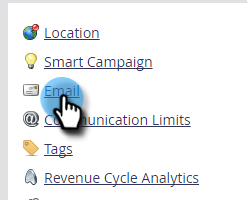

# Supprimer un domaine de branding {#delete-a-branding-domain}

1. Accédez à la zone **[!UICONTROL Admin]**.

   

1. Cliquez sur **[!UICONTROL E-mail]**.

   

1. Dans le tableau Domaines de branding , sélectionnez le domaine à supprimer, puis cliquez sur **[!UICONTROL Supprimer]**.

   

   >[!NOTE]
   >
   >Si vous souhaitez supprimer le domaine de branding principal, vous devez d’abord sélectionner un autre domaine de branding pour qu’il soit le principal.
