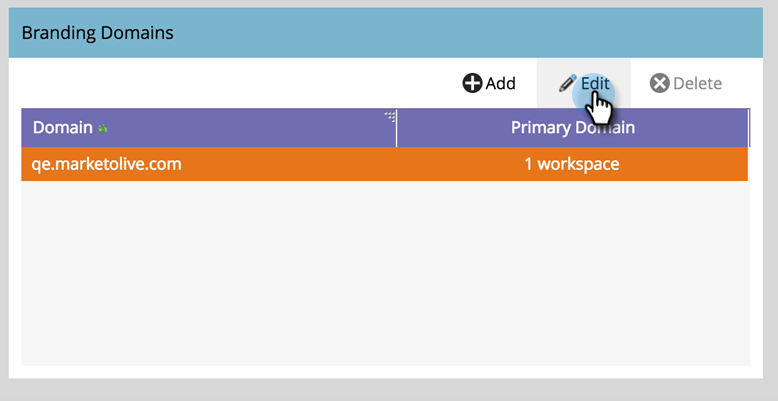
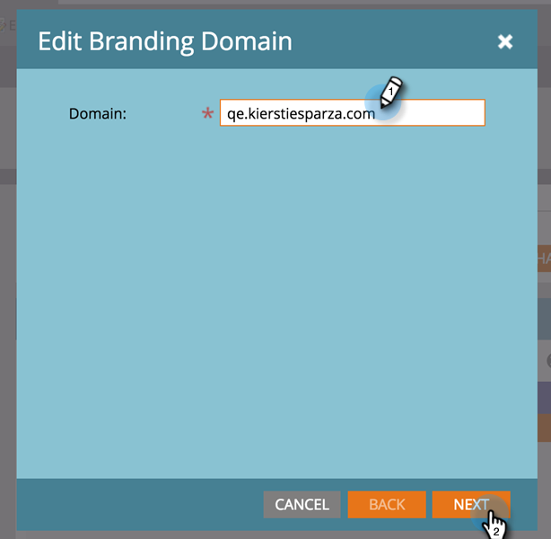
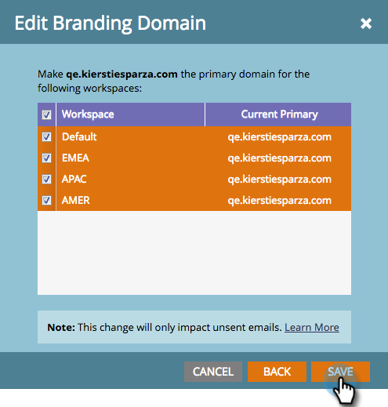

# Modifier votre domaine de branding par défaut avec des espaces de travail {#edit-your-default-branding-domain-with-workspaces}

1. Accédez à la zone **[!UICONTROL Admin]**.

   

1. Cliquez sur **[!UICONTROL E-mail]**.

   

1. Dans le tableau [!UICONTROL Domaines de marque], sélectionnez le domaine générique actuel et cliquez sur **[!UICONTROL Modifier]** pour le modifier en domaine de marque de votre société.

   

   >[!NOTE]
   >
   >**[!UICONTROL Ajouter]** ne fonctionne pas tant que vous n’avez pas modifié le domaine générique. **[!UICONTROL Supprimer]** ne fonctionne pas tant que vous n’avez pas ajouté un second domaine.

1. Saisissez le nom de votre domaine par défaut et cliquez sur **[!UICONTROL Suivant]**.

   

1. Cliquez sur **[!UICONTROL Enregistrer]**

   

>[!NOTE]
>
>Lors de l’ajout de domaines de branding supplémentaires, vous pouvez choisir d’en faire votre domaine principal pour un ou plusieurs espaces de travail, et tous les e-mails non envoyés existants définis sur « Par défaut » et tous les e-mails nouvellement créés seront définis par défaut sur le domaine principal. Vous pouvez modifier ce paramètre par e-mail.

Vous pouvez désormais [ajouter des domaines de branding supplémentaires](/help/marketo/product-docs/administration/email-setup/add-multiple-branding-domains/add-an-additional-branding-domain-with-workspaces.md) dont vous avez besoin pour les espaces de travail.
