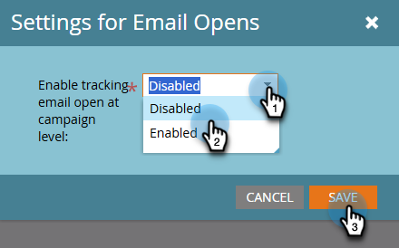

# Suivi des ouvertures d’e-mails au niveau de la campagne {#email-open-tracking-at-campaign-level}

Cette fonctionnalité vous permet de contrôler le suivi des ouvertures d’e-mails, soit une fois pour chaque ouverture dans une campagne, soit une seule fois pour chaque e-mail, quel que soit le nombre de fois où il est utilisé dans différentes campagnes.

>[!NOTE]
>
>**Autorisations d’administration requises**

1. Accédez à la zone **[!UICONTROL Admin]**.

   

1. Cliquez sur **[!UICONTROL Campagne intelligente]**.

   

1. En regard de _Paramètres des ouvertures d’e-mail_, cliquez sur **[!UICONTROL Modifier]**.

   

1. Cliquez sur la liste déroulante, choisissez le paramètre souhaité, puis cliquez sur **[!UICONTROL Enregistrer]**.

   

<table><tbody>
  <tr>
    <td><b>Activé</b></td>
    <td>Les ouvertures d’e-mails sont suivies séparément pour chaque campagne.</td>
  </tr>
  <tr>
    <td><b>Désactivé</b></td>
    <td>Les ouvertures d’e-mails sont comptabilisées uniquement en fonction des ouvertures de personne uniques.</td>
  </tr>
</tbody>
</table>
