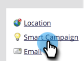
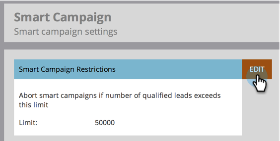
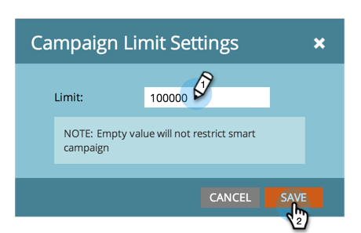

# Activer les restrictions de personne pour les campagnes intelligentes {#enable-person-restrictions-for-smart-campaigns}

Marketo offre une fonctionnalité permettant de limiter le nombre _maximum_ de personnes pouvant se qualifier pour une campagne intelligente. Cela évite d’envoyer accidentellement par e-mail l’ensemble de votre base de données.

>[!NOTE]
>
>**Autorisations d’administration requises**

>[!CAUTION]
>
>Cela s’applique uniquement aux campagnes par lots et aux programmes de messagerie.

1. Accédez à la zone **[!UICONTROL Admin]**.

   

1. Cliquez sur **[!UICONTROL Campagne intelligente]**.

   

1. Cliquez sur **[!UICONTROL Modifier]**.

   

   >[!CAUTION]
   >
   >Si le nombre de personnes pouvant être exécutées par une campagne intelligente dépasse la limite définie, l’opération ne sera pas exécutée du tout.

1. Saisissez une limite et cliquez sur **[!UICONTROL Enregistrer]**.

   

   >[!TIP]
   >
   >Désactivez cette fonctionnalité en laissant ce champ vide.

   >[!CAUTION]
   >
   >Cette limite est appliquée à toutes les campagnes intelligentes, mais peut être remplacée au niveau de la campagne. Découvrez comment [remplacer les restrictions de personne dans une campagne dynamique](/help/marketo/product-docs/core-marketo-concepts/smart-campaigns/using-smart-campaigns/override-person-restrictions-in-a-smart-campaign.md).

>[!MORELIKETHIS]
>
>[Remplacer les restrictions de personne dans une campagne dynamique](/help/marketo/product-docs/core-marketo-concepts/smart-campaigns/using-smart-campaigns/override-person-restrictions-in-a-smart-campaign.md)
