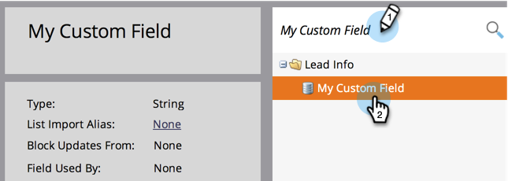
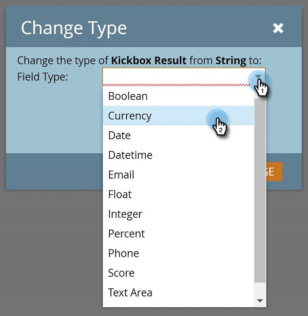
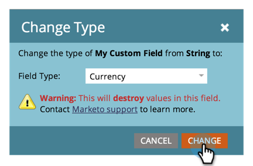

# Modifier le type d’un champ personnalisé Marketo {#change-the-type-of-a-marketo-custom-field}

Découvrez comment modifier le type d’un champ personnalisé.

1. Accédez à la zone **[!UICONTROL Admin]**.

   

1. Cliquez sur **[!UICONTROL Gestion des champs]**.

   

1. Recherchez et sélectionnez le champ de votre choix.

   

1. Dans la liste déroulante **[!UICONTROL Actions de champ]**, cliquez sur **[!UICONTROL Modifier le type]**.

   

1. Sélectionnez le nouveau type.

   >[!NOTE]
   >
   >Les champs de score et de formule ne peuvent pas être modifiés.

   

1. Lisez l’avertissement, puis cliquez sur **[!UICONTROL Modifier]** pour confirmer.

   

   >[!NOTE]
   >
   >Le message d’avertissement qui s’affiche varie selon le type de champ que vous modifiez de et en.

   >[!MORELIKETHIS]
   >
   >[Créer un champ personnalisé dans Marketo](/help/marketo/product-docs/administration/field-management/create-a-custom-field-in-marketo.md)
