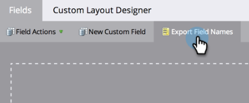
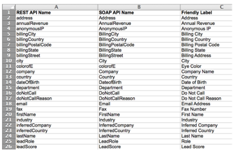

# Exporter une liste de tous les noms de champ d’API Marketo {#export-a-list-of-all-marketo-api-field-names}

Si vous utilisez le [!DNL SOAP API] ou le [!DNL Munchkin API] , vous aurez besoin d’une liste de tous vos champs et de leurs noms d’API.

>[!NOTE]
>
>**Autorisations d’administration requises**

1. Accédez à la zone **[!UICONTROL Admin]**.

   

1. Cliquez sur **[!UICONTROL Gestion des champs]**.

   

1. Cliquez sur **[!UICONTROL Exporter les noms de champ]** pour télécharger la feuille de calcul.

   

Vous disposez désormais d’une feuille de calcul contenant la liste de tous vos champs et leurs noms d’API.

>[!NOTE]
>
>La limite de caractères pour les noms d’API MLM est de 255.
