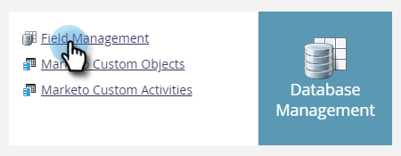
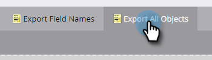

# Exporter toutes les métadonnées d’objet {#export-all-object-metadata}

Cette fonctionnalité vous permet d’exporter tous les objets et leurs métadonnées.

>[!NOTE]
>
>**Autorisations d’administration requises**

## Objets {#objects}

* Champs de lead (personne/entreprise)
* Objets personnalisés Marketo
* Activités standard
* Activités personnalisées
* Canaux
* Balises

## Exporter les métadonnées d&#39;objet {#export-object-metadata}

1. Accédez à la zone **[!UICONTROL Admin]**.

   

1. Cliquez sur **[!UICONTROL Gestion des champs]**.

   

1. Cliquez Sur **[!UICONTROL Exporter Tous Les Objets]**.

   

>[!NOTE]
>
>Assurez-vous que votre navigateur ne bloque pas les fenêtres pop-up de Marketo.

Les données sont exportées au format CSV.

