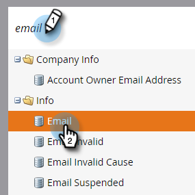

# Exporter les données « Utilisé par » pour un champ {#export-used-by-data-for-a-field}

En tant qu’administrateur, vous pouvez exporter les ressources associées d’un champ afin de déléguer leur suppression à votre équipe.

>[!NOTE]
>
>**Autorisations d’administration requises**

1. Accédez à la zone **[!UICONTROL Admin]**.

   

1. Cliquez sur **[!UICONTROL Gestion des champs]**.

   

1. Recherchez le champ souhaité et sélectionnez-le.

   

1. Cliquez sur le menu déroulant **[!UICONTROL Actions de champ]** et sélectionnez **[!UICONTROL Exporter utilisé par]**.

   

1. Un fichier [!DNL Excel] est exporté. Ouvrez-le pour afficher son contenu.

   

   >[!TIP]
   >
   >Chaque ressource associée est un lien sur lequel vous pouvez cliquer et qui s’ouvre dans Marketo.
