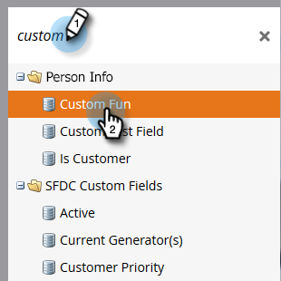
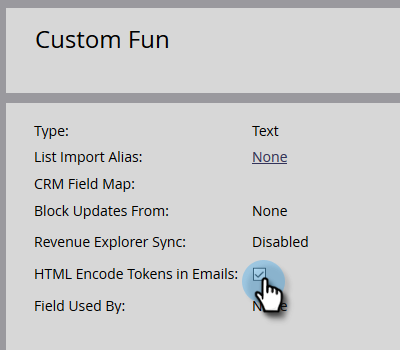

# Encodage des jetons en HTML dans les e-mails {#html-encode-tokens-in-emails}

Activez ou désactivez les jetons de personne et d’entreprise utilisés dans les e-mails.

>[!NOTE]
>
>**Autorisations d’administration requises**

>[!NOTE]
>
>Le codage convertit les caractères dans leurs versions de code HTML pour éviter toute confusion lors de la transmission (c’est-à-dire que «&amp; » est remplacé par `&amp;`). Pour plus de détails, consultez un développeur Web.

1. Accédez à la zone **[!UICONTROL Admin]**.

   

1. Cliquez sur **[!UICONTROL Gestion des champs]**.

   

1. Recherchez et sélectionnez le champ de votre choix.

   

1. Cochez la case **[!UICONTROL Jetons de codage HTML dans les e-mails]** pour l’activer, décochez la case pour la désactiver.

   

   Répétez l’opération pour chaque champ supplémentaire selon vos besoins.
