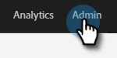
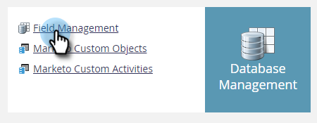
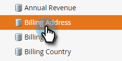
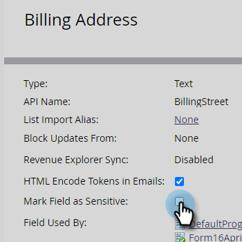

# Marquer un champ comme sensible {#mark-a-field-as-sensitive}

En tant qu’administrateur Marketo, vous pouvez marquer un champ spécifique comme « sensible » afin que ses valeurs ne soient jamais préremplies dans les formulaires, protégeant ainsi les données sensibles des utilisateurs.

1. Cliquez sur **[!UICONTROL Admin]**.

   

1. Cliquez sur **[!UICONTROL Gestion des champs]**.

   

1. Recherchez et sélectionnez le champ de votre choix.

   

1. Cochez la case **[!UICONTROL Marquer le champ comme sensible]**.

   
