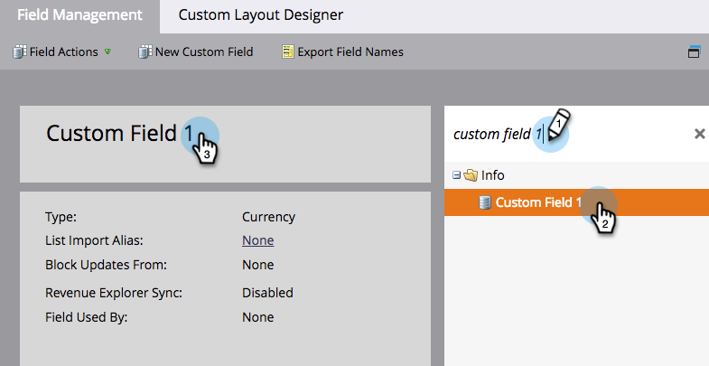
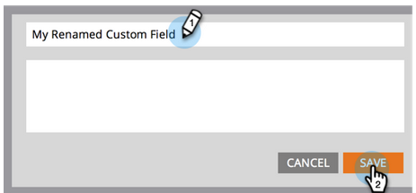

# Renommer un champ {#rename-a-field}

>[!NOTE]
>
>Vous pouvez renommer un champ personnalisé dans Marketo. Cependant, vous devez supprimer toute utilisation de dans le système avant de le faire. Cela inclut les formulaires, les listes intelligentes et les campagnes intelligentes.

>[!NOTE]
>
>**Autorisations d’administration requises**

1. Accédez à la zone **[!UICONTROL Admin]**.

   

1. Cliquez sur **[!UICONTROL Gestion des champs]**.

   

1. Recherchez et sélectionnez le champ à renommer, puis cliquez sur le nom du champ dans la zone de travail.

   

   >[!TIP]
   >
   >Cliquez sur le lien **[!UICONTROL Utilisé par]** pour rechercher les ressources qui font référence à ce champ.

1. Renommez le champ et cliquez sur **[!UICONTROL Enregistrer]**.

   

Vous savez désormais comment renommer des champs dans Marketo.

>[!CAUTION]
>
>Si vous renommez le nom de l’API dans [!DNL Salesforce], Marketo crée un tout nouveau champ et laisse l’ancien derrière.
