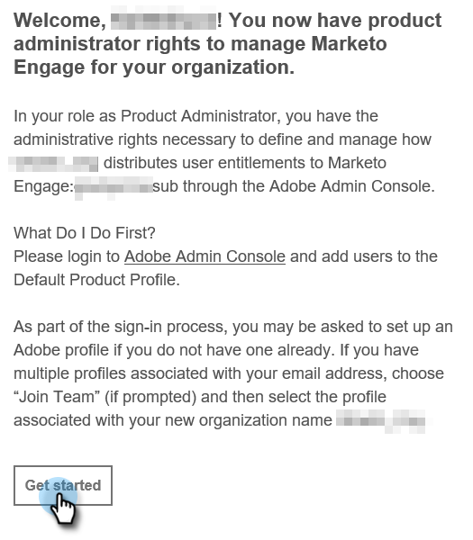
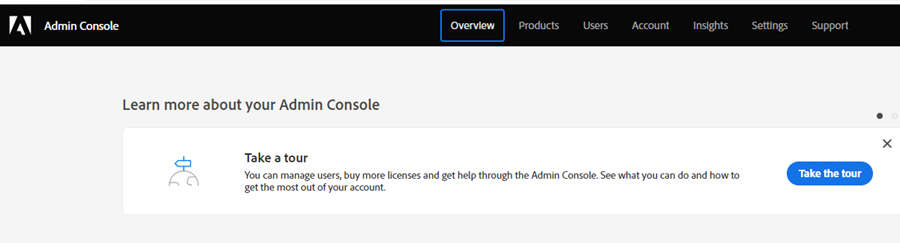

# Configuration de l’administrateur ou de l’administratrice de produit {#product-admin-setup}

1. Après avoir été invité par un administrateur système, vous recevrez un e-mail de bienvenue. Dans cet e-mail, cliquez sur **[!UICONTROL Commencer]**.

   

1. Si vous avez déjà accédé à une application à l’aide d’une Adobe ID, vous accédez directement au Adobe Admin Console. Dans le cas contraire, [configurez votre Adobe ID](https://helpx.adobe.com/manage-account/using/create-update-adobe-id.html){target="_blank"}.

   

Les administrateurs de produit sont principalement chargés d’ajouter des utilisateurs. [Découvrez comment faire ici](/help/marketo/product-docs/administration/users-and-roles/add-or-remove-a-user.md#add-a-user){target="_blank"}.
