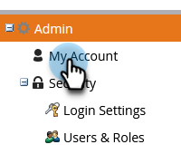
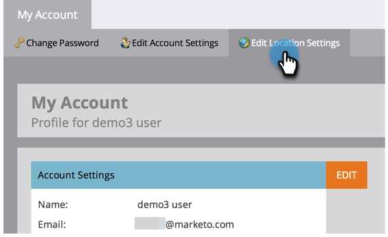
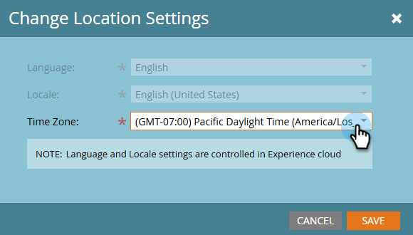

# Modifier Votre Fuseau Horaire {#change-time-zone}

Découvrez comment modifier le fuseau horaire dans votre abonnement Marketo Engage.

1. Accédez à la zone **[!UICONTROL Admin]**.

   

1. Sélectionnez **[!UICONTROL Mon compte]**.

   

1. Cliquez sur l’onglet **[!UICONTROL Modifier les paramètres d’emplacement]**.

   

1. Une boîte de dialogue modale s’affiche. Cliquez sur le menu déroulant **[!UICONTROL Fuseau horaire]** et effectuez votre sélection.

   

   >[!NOTE]
   >
   >_Langue_ et _paramètres régionaux_ sont grisés, car ces paramètres doivent être accessibles dans votre profil de compte [Adobe](https://account.adobe.com/profile){target="_blank"}.

1. Cliquez sur **[!UICONTROL Enregistrer]**
