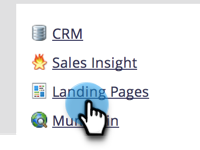
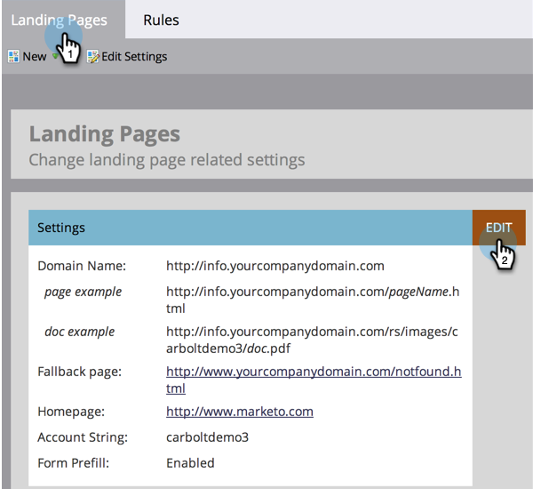
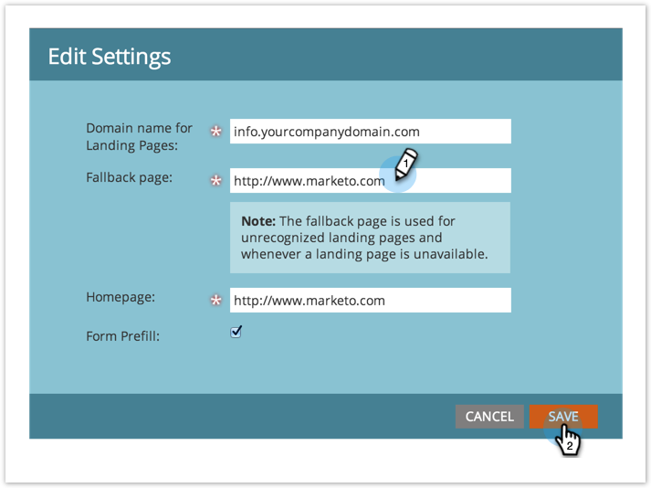

# Définir une page de secours {#set-a-fallback-page}

Les pages de secours constituent la dernière ligne de défense si votre page de destination est hors ligne ou introuvable. Assurez-vous d’en avoir un configuré.

>[!NOTE]
>
>**Autorisations d’administration requises**

1. Dans Mon Marketo, cliquez sur **[!UICONTROL Admin]**.

   

1. Cliquez sur **[!UICONTROL Pages de destination]**.

   

1. Sous l’onglet **[!UICONTROL Pages de destination]**, cliquez sur **[!UICONTROL Modifier]**.

   

1. Saisissez une **[!UICONTROL Page de secours]** dans la boîte de dialogue, puis cliquez sur **[!UICONTROL Enregistrer]**.

   
