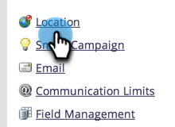
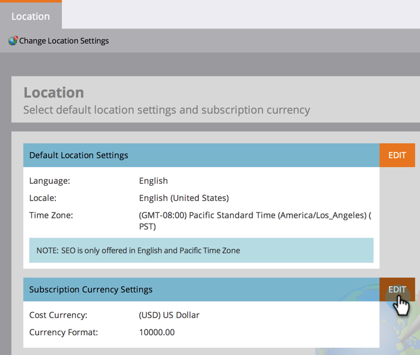
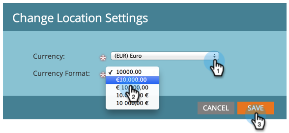

# Définir la devise par défaut {#set-default-currency}

Découvrez comment afficher et modifier la devise par défaut pour votre abonnement Marketo Engage.

>[!NOTE]
>
>**Autorisations d’administrateur requises.**

1. Dans Mon Marketo, cliquez sur **[!UICONTROL Admin]**.

   

1. Cliquez sur **[!UICONTROL Emplacement]**.

   

1. Cliquez sur **[!UICONTROL Modifier]** dans [!UICONTROL Paramètres de devise d’abonnement].

   

1. Sélectionnez le format monétaire de votre choix et cliquez sur **[!UICONTROL Enregistrer]**.

   
