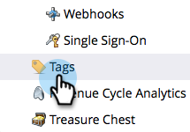
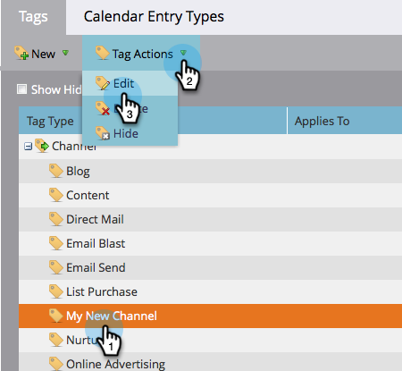
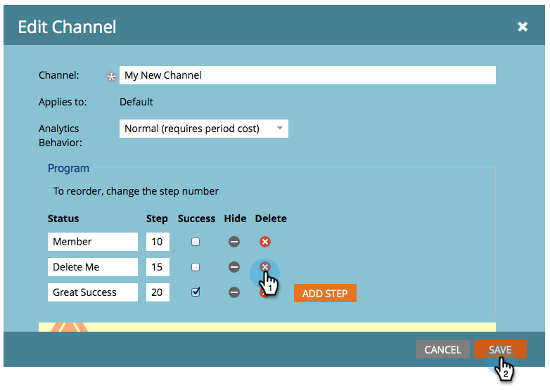

# Supprimer un statut de programme d’un canal de programme {#delete-a-program-status-from-a-program-channel}

Les statuts du programme sont les points de contrôle via le chemin d’accès (canal) d’un programme. Si vous créez un statut par erreur ou que vous n’en avez plus besoin, vous pouvez le supprimer.

1. Accédez à la zone **[!UICONTROL Admin]**.

   

1. Cliquez sur **[!UICONTROL Balises]**.

   

1. Sélectionnez le canal depuis lequel vous souhaitez supprimer un statut, puis sous **[!UICONTROL Actions de balise]**, cliquez sur **[!UICONTROL Modifier]**.

   

1. Cliquez sur le rouge **X** pour supprimer le statut, puis cliquez sur **[!UICONTROL Enregistrer]**.

   

   >[!TIP]
   >
   >Si une personne est actuellement affectée au statut en question, vous ne pouvez pas la supprimer, mais vous pouvez la masquer.

Vous pouvez également [supprimer un canal entier](/help/marketo/product-docs/administration/tags/delete-a-program-channel.md) si nécessaire.
