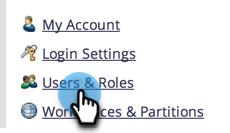

# Modifier les espaces de travail utilisateur {#edit-user-workspaces}

1. Accédez à la zone **[!UICONTROL Admin]**.

   

1. Cliquez sur **[!UICONTROL Utilisateurs et rôles]**.

   

1. Sélectionnez l’utilisateur souhaité, puis cliquez sur **[!UICONTROL Modifier l’utilisateur]**.

   

1. Apportez les modifications souhaitées et cliquez sur **[!UICONTROL Enregistrer]**.

   
