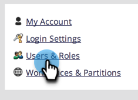
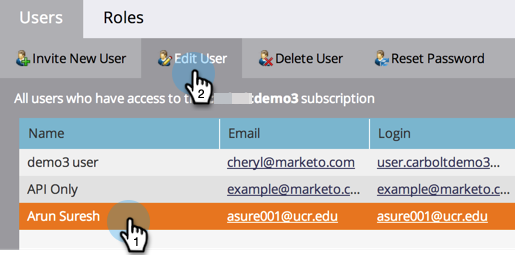
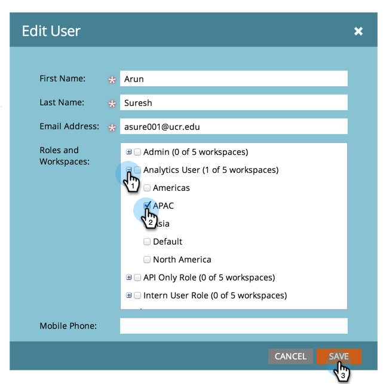
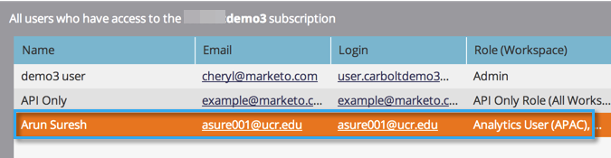

# Accorder l’accès à un espace de travail à un utilisateur ou à une utilisatrice {#allow-user-access-to-a-workspace}

Les espaces de travail peuvent être utilisés pour n’importe quelle raison (séparation d’unités commerciales ou géographique, par exemple). Ils séparent les ressources (listes dynamiques, programmes, etc.) de chaque équipe.

>[!NOTE]
>
>**Autorisations d’administration requises**

>[!NOTE]
>
>En savoir plus sur les [espaces de travail](/help/marketo/product-docs/administration/workspaces-and-person-partitions/understanding-workspaces-and-person-partitions.md).

1. Accédez à la zone **[!UICONTROL Admin]**.

   

1. Cliquez sur **[!UICONTROL Utilisateurs et rôles]**.

   

1. Sous l’onglet **[!UICONTROL Utilisateurs]**, sélectionnez l’utilisateur et cliquez sur **[!UICONTROL Modifier l’utilisateur]**.

   

1. Sélectionnez les **[!UICONTROL Rôles et espaces de travail]** auxquels l’utilisateur doit avoir accès.

   

   >[!NOTE]
   >
   >Vous pouvez autoriser vos utilisateurs à disposer de n’importe quelle combinaison d’accès aux espaces de travail.

Après avoir enregistré les modifications, vous devriez voir la mise à jour.

