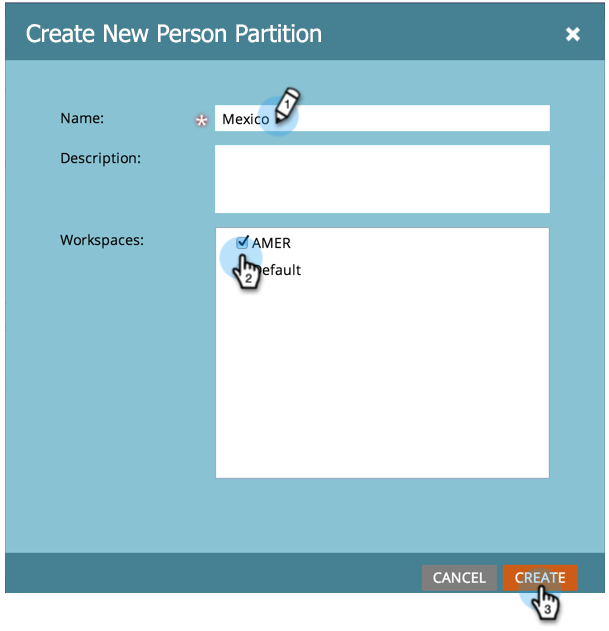
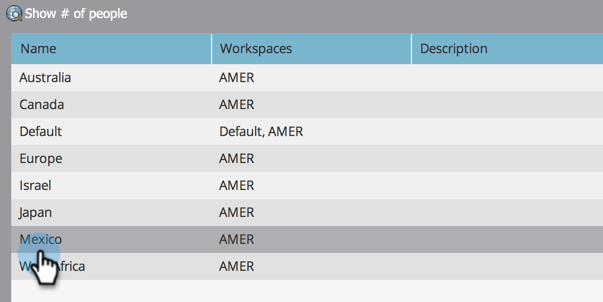

# Créer une partition de personnes {#create-a-person-partition}

Créez une partition de personne en suivant ces étapes.

>[!NOTE]
>
>**Autorisations d’administration requises**

>[!NOTE]
>
>Pour plus d’informations, voir [Présentation des espaces de travail et des partitions de personne](/help/marketo/product-docs/administration/workspaces-and-person-partitions/understanding-workspaces-and-person-partitions.md).

1. Accédez à la zone **[!UICONTROL Admin]**.

   

1. Cliquez sur **[!UICONTROL Workspaces et partitions]**.

   

1. Accédez à l’onglet **[!UICONTROL Partitions de personne]** et cliquez sur **[!UICONTROL Nouvelle partition de personne]**.

   

1. Nommez votre partition, choisissez l’**[!UICONTROL espaces de travail]** où elle apparaîtra, puis cliquez sur **[!UICONTROL Créer]**.

   

Après avoir créé la partition, vous devriez voir la mise à jour.

>[!TIP]
>
>Vous pouvez sélectionner une partition de personne spécifique dans laquelle filtrer les personnes pendant le processus d’importation de la [liste](https://experienceleague.adobe.com/fr/docs/marketo/using/getting-started/quick-wins/import-a-list-of-people#step-import-your-spreadsheet-into-marketo:~:text=If%20you%20have%20Person%20Partitions%20set%20up){target="_blank"}.
