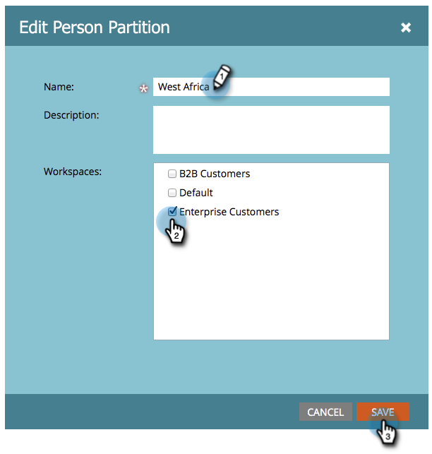

# Modifier une partition de personnes existante {#edit-an-existing-person-partition}

Une partition de personne est semblable à une deuxième (ou troisième) base de données. Une partition peut être connectée à un ou plusieurs espaces de travail.

>[!NOTE]
>
>**Autorisations d’administration requises**

>[!PREREQUISITES]
>
>[Créer une partition de personne](/help/marketo/product-docs/administration/workspaces-and-person-partitions/create-a-person-partition.md){target="_blank"}

1. Accédez à la zone **[!UICONTROL Admin]**.

   

1. Cliquez sur **[!UICONTROL Workspaces et partitions]**.

   

1. Sous l’onglet **[!UICONTROL Partitions de personne]**, sélectionnez la partition de personne à modifier et cliquez sur **[!UICONTROL Modifier la partition de personne]**.

   

1. Saisissez la partition de la personne **[!UICONTROL Nom]** et les **[!UICONTROL Espaces de travail]** auxquels ils appartiennent, puis cliquez sur **[!UICONTROL Enregistrer]**.

   

Après avoir enregistré les modifications, la mise à jour s’affiche.

