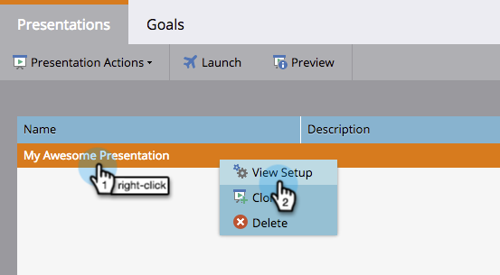
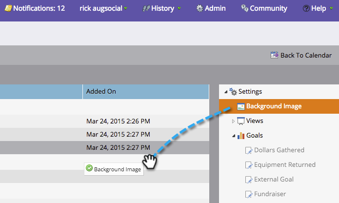
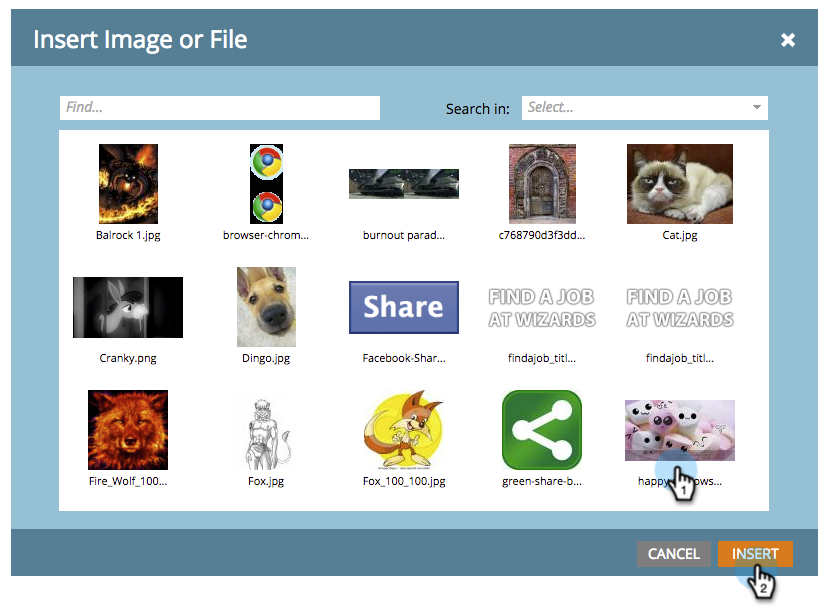
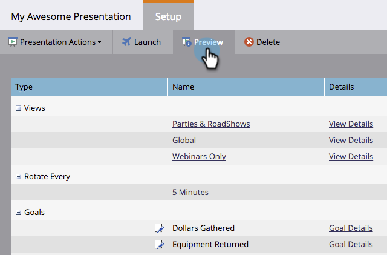

# Ajouter une image d’arrière-plan à une présentation {#add-a-background-image-to-a-presentation}

Personnaliser une présentation en sélectionnant une image d&#39;arrière-plan.

>[!PREREQUISITES]
>
>[Créer une présentation](/help/marketo/product-docs/core-marketo-concepts/marketing-calendar/calendar-hd/create-a-presentation.md)

1. Cliquez avec le bouton droit sur une présentation et sélectionnez **[!UICONTROL Afficher la configuration]**.

   >[!NOTE]
   >
   >Vous pouvez également double-cliquer sur une présentation pour accéder à l&#39;onglet de configuration.

   

1. Effectuez un glisser-déposer de **[!UICONTROL Image d’arrière-plan]** de l’arborescence de droite dans la zone de travail.

   

1. Sélectionnez une image dans la bibliothèque d’images.

   >[!TIP]
   >
   >Pour un aspect plus épuré, utilisez une image de 1 920 **x 1 080** ou de 1 280 **x 720**.

   

1. Cliquez sur **[!UICONTROL Aperçu]** pour le prévisualiser.

   

