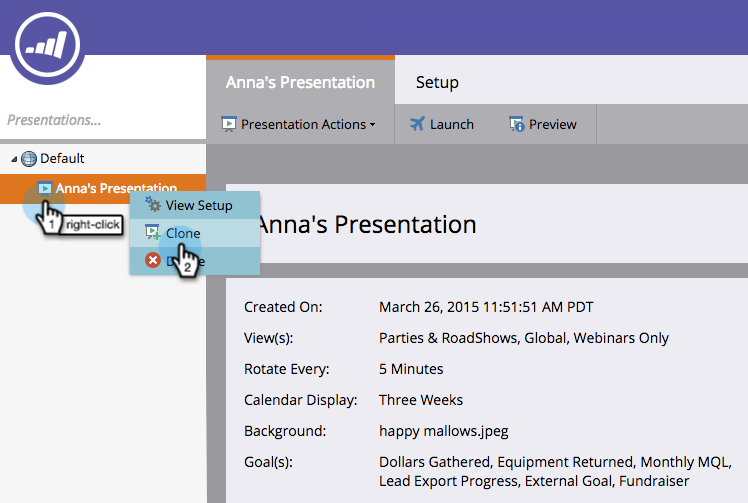

# Cloner une présentation {#clone-a-presentation}

Clonez une présentation pour la réutiliser à différents endroits.

1. Sélectionnez la présentation à cloner.

   

1. Cliquez avec le bouton droit sur la présentation et sélectionnez **[!UICONTROL Cloner]**.

   

1. Saisissez le nom de la présentation clonée, puis cliquez sur **[!UICONTROL Cloner]**.

   

   Une copie exacte de votre présentation existe maintenant.
