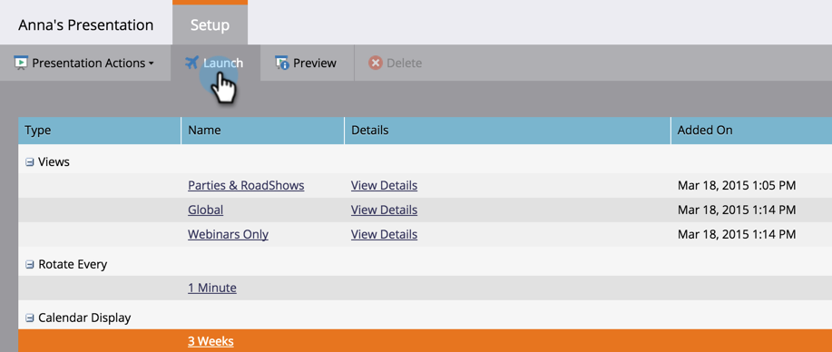
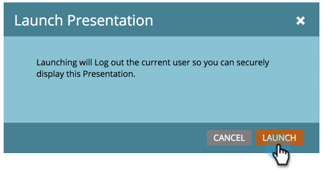

# Lancer une présentation {#launch-a-presentation}

Une fois les vues et la fréquence de rotation définies, la présentation est prête à démarrer.

>[!AVAILABILITY]
>
>
>Tous les utilisateurs de Marketo Engage n’ont pas acheté cette fonctionnalité. Pour plus d’informations, contactez l’équipe du compte Adobe (votre gestionnaire de compte).

>[!PREREQUISITES]
>
>* [Créer une présentation](/help/marketo/product-docs/core-marketo-concepts/marketing-calendar/calendar-hd/create-a-presentation.md)
>* [Personnaliser une présentation](/help/marketo/product-docs/core-marketo-concepts/marketing-calendar/calendar-hd/customize-a-presentation.md)

>[!TIP]
>
>Prévisualisez la présentation avant le lancement.

1. Cliquez sur **[!UICONTROL Lancer]**.

   

1. Cliquez de nouveau sur **[!UICONTROL Lancer]**. Vous serez ainsi déconnecté de Marketo afin que la présentation puisse être affichée en toute sécurité.

   

   >[!TIP]
   >
   >Votre présentation s&#39;ouvre dans un nouvel onglet. Si nécessaire, déplacez l’onglet vers un moniteur externe pour l’afficher, puis cliquez sur **[!UICONTROL Plein écran]**.
