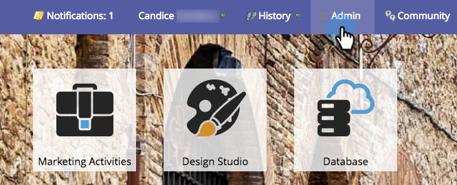
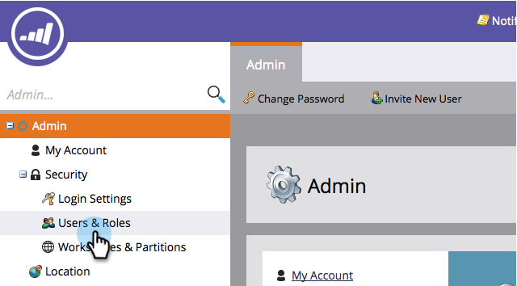
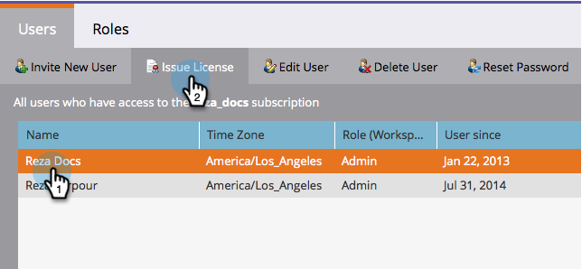
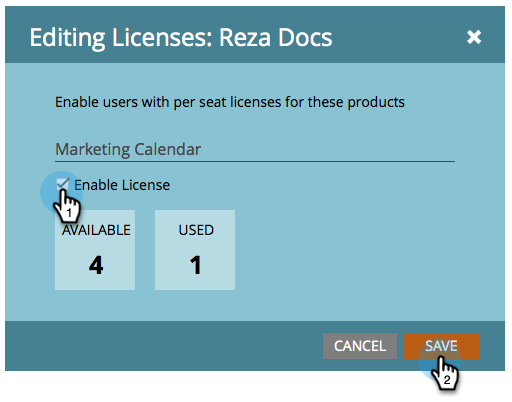
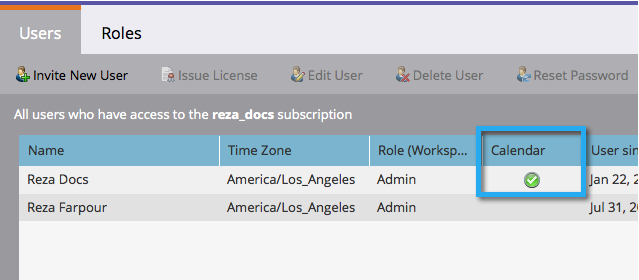

# Émettre ou révoquer une licence de calendrier marketing {#issue-revoke-a-marketing-calendar-license}

>[!NOTE]
>
>**Autorisations d’administration requises**

Pour utiliser vos places [Calendrier marketing](/help/marketo/product-docs/core-marketo-concepts/marketing-calendar/understanding-the-calendar/navigating-the-marketing-calendar.md){target="_blank"}, vous devez attribuer des licences aux utilisateurs qui ont besoin d’un accès.

1. Accédez à la section **[!UICONTROL Admin]**.

   

1. Cliquez sur **[!UICONTROL Utilisateurs et rôles]**.

   

1. Sélectionnez le ou les utilisateurs et cliquez sur **[!UICONTROL Émettre une licence]**.

   >[!TIP]
   >
   >Utilisez **Ctrl/Cmd+clic** pour sélectionner plusieurs utilisateurs en une seule fois.

   

1. Cochez **[!UICONTROL Activer la licence]** et cliquez sur **[!UICONTROL Enregistrer]**.

   >[!NOTE]
   >
   >Il y a une limite de 5 licences. Pour en savoir plus, contactez votre représentant commercial.

   

   La coche verte devrait maintenant apparaître sous &#39;[!UICONTROL Calendrier].&#39;

   
