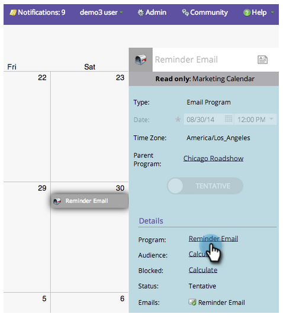

# Afficher les détails d’une entrée {#view-entry-details}

1. Sélectionnez une entrée dans le calendrier.

   

1. Les entrées sont en lecture seule dans le calendrier marketing. Accédez au programme pour apporter des modifications.

   

>[!TIP]
>
>Cliquez avec le bouton droit sur le panneau des détails pour accéder aux menus de navigation ou ouvrir les éditeurs.
