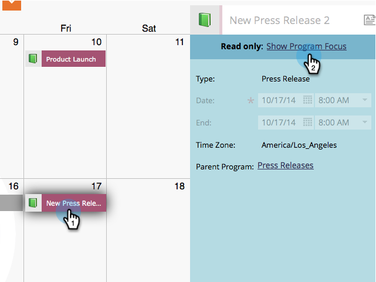
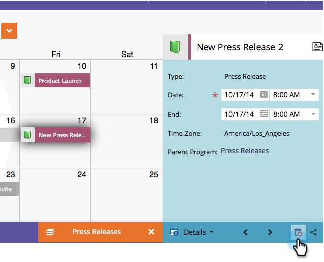

# Supprimer des entrées directement dans le calendrier marketing {#delete-entries-directly-in-the-marketing-calendar}

Outre les entrées [création](/help/marketo/product-docs/core-marketo-concepts/marketing-calendar/working-with-the-calendar/create-entries-directly-in-the-marketing-calendar.md){target="_blank"} et [modification](/help/marketo/product-docs/core-marketo-concepts/marketing-calendar/working-with-the-calendar/edit-entries-directly-in-the-marketing-calendar.md){target="_blank"}, vous pouvez les supprimer directement dans le calendrier marketing.

1. Cliquez sur la mosaïque **MU**.

   

1. Sélectionnez l’entrée à supprimer et cliquez sur **[!UICONTROL Afficher le focus du programme]**.

   

1. Cliquez sur l’icône de corbeille.

   

Selon l’entrée, vous devrez peut-être confirmer la suppression.

>[!MORELIKETHIS]
>
>[Confirmer les entrées directement dans le calendrier marketing](/help/marketo/product-docs/core-marketo-concepts/marketing-calendar/working-with-the-calendar/confirm-entries-directly-in-the-marketing-calendar.md){target="_blank"}
