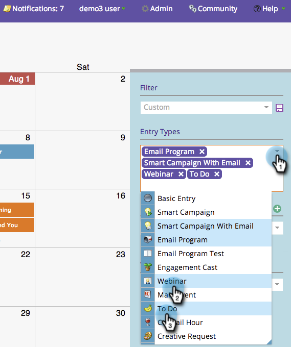
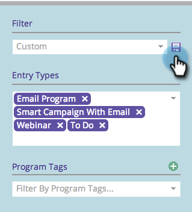
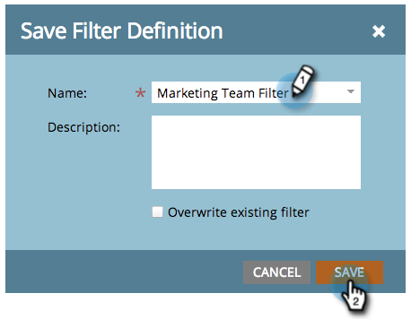
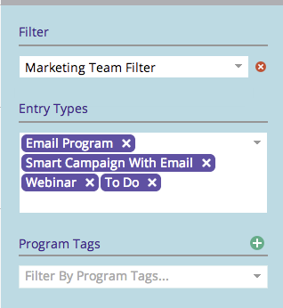

# Enregistrement d’une définition de filtre dans le calendrier marketing {#saving-a-filter-definition-in-the-marketing-calendar}

L’enregistrement d’un filtre vous permet de basculer entre différentes définitions de filtre.

>[!PREREQUISITES]
>
>[Filtrer le calendrier marketing](/help/marketo/product-docs/core-marketo-concepts/marketing-calendar/working-with-the-calendar/filtering-the-marketing-calendar.md){target="_blank"}

1. Définissez le filtre.

   

1. Cliquez sur l’icône Enregistrer .

   

1. Nommez le filtre. Cliquez sur **[!UICONTROL Enregistrer]**

   

   Le filtre est maintenant enregistré.

   

   Vous pouvez éventuellement [envoyer une copie](/help/marketo/product-docs/core-marketo-concepts/marketing-calendar/working-with-the-calendar/sharing-a-filter-definition-in-the-marketing-calendar.md){target="_blank"} de la définition à d’autres utilisateurs de Marketo.

   >[!NOTE]
   >
   >[Partager une définition de filtre dans le calendrier marketing](/help/marketo/product-docs/core-marketo-concepts/marketing-calendar/working-with-the-calendar/sharing-a-filter-definition-in-the-marketing-calendar.md){target="_blank"}
