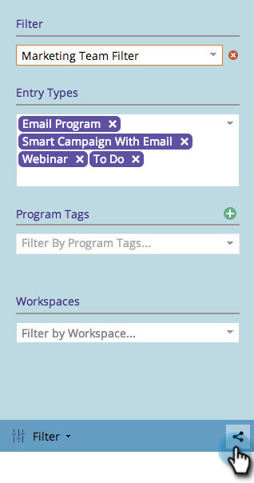
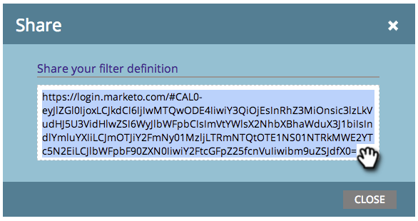

# Partage d’une définition de filtre dans le calendrier marketing {#sharing-a-filter-definition-in-the-marketing-calendar}

Les filtres peuvent être partagés entre différents utilisateurs.

>[!PREREQUISITES]
>
>* [Créer un filtre dans le calendrier marketing](/help/marketo/product-docs/core-marketo-concepts/marketing-calendar/working-with-the-calendar/filtering-the-marketing-calendar.md)
>* [Enregistrer une définition de filtre dans le calendrier marketing](/help/marketo/product-docs/core-marketo-concepts/marketing-calendar/working-with-the-calendar/saving-a-filter-definition-in-the-marketing-calendar.md)

>[!NOTE]
>
> Si vous apportez une modification à un filtre enregistré, partagez-le à nouveau ; vos modifications ne seront pas répercutées pour les autres utilisateurs tant que vous ne l’aurez pas fait.

1. Sélectionnez le filtre à partager.

   

1. Cliquez sur l’icône de partage dans le coin inférieur droit.

   

1. Copiez l’URL et partagez-la avec d’autres utilisateurs de Marketo.

   

   >[!NOTE]
   >
   >Les autorisations utilisateur affecteront la visibilité.
