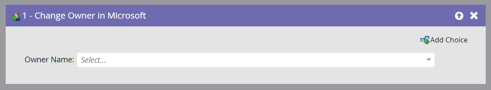

# Changer de propriétaire dans Microsoft {#change-owner-in-microsoft}

Si des personnes existantes sont déjà affectées à un propriétaire, vous pouvez utiliser cette étape de flux pour les réaffecter à un autre propriétaire.

>[!NOTE]
>
>Cette étape de flux _ne fonctionne qu’avec des déclencheurs_ et non des filtres, dans votre campagne dynamique.

**Utilisation**

1. Choisissez simplement le propriétaire que vous souhaitez changer et partez !

   

   >[!NOTE]
   >
   >Si l&#39;enregistrement n&#39;existe pas encore dans votre compte Dynamics, nous le synchroniserons, puis l&#39;affecterons à l&#39;utilisateur sélectionné.
