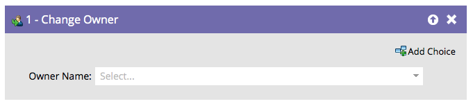
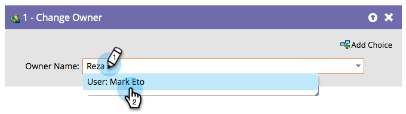

# Modifier l’entité propriétaire {#change-owner}

Si des personnes existantes sont déjà affectées à un propriétaire, vous pouvez utiliser cette étape de flux pour les réaffecter à un autre propriétaire.

1. Il vous suffit de sélectionner le propriétaire ou la file d’attente de leads vers laquelle vous souhaitez apporter des modifications et de quitter !

   

   >[!CAUTION]
   >
   >[!DNL Salesforce] ne permet pas d’affecter des contacts aux files d’attente de leads. Pour un enregistrement qui est un contact SFDC :
   >
   >* Marketo crée un prospect en double **uniquement** lorsque le contact est synchronisé avec Salesforce. En d’autres termes, si vous utilisez l’étape de flux **[Synchroniser la personne avec SFDC](/help/marketo/product-docs/core-marketo-concepts/smart-campaigns/salesforce-flow-actions/sync-person-to-sfdc.md)** avec `AssignTo=<a lead queue>`, Marketo crée un prospect en double dans Salesforce et l’affecte à la file d’attente de prospects.
   >
   >* Si vous utilisez l’étape de flux **[!UICONTROL Modifier le propriétaire]** sur un contact, Marketo crée un prospect en double dans Salesforce. Pour éviter cela, utilisez un filtre sur le champ « Type de SFDC » qui limite l’action aux prospects uniquement.

   >[!NOTE]
   >
   >Si l’enregistrement n’existe pas encore dans votre compte [!DNL Salesforce], nous le synchroniserons, puis l’affecterons à l’utilisateur sélectionné.
