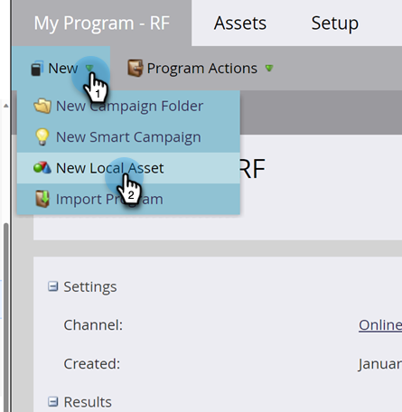
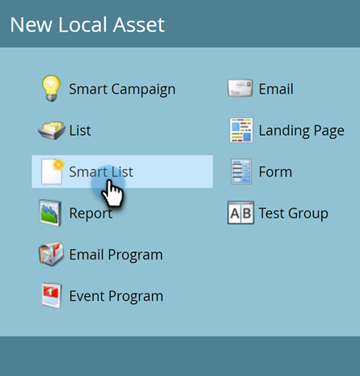
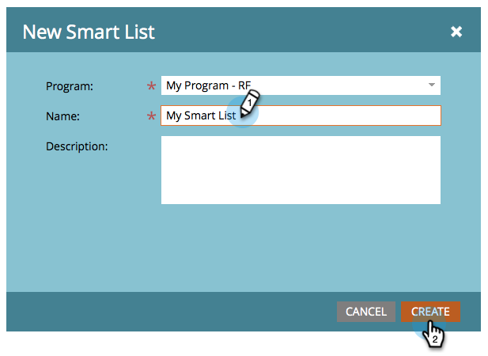

# Créer une liste intelligente {#create-a-smart-list}

Les listes dynamiques vous permettent de trouver des groupes spécifiques de personnes à l’aide de filtres simples.

1. Accédez à **[!UICONTROL Activités marketing]**.

   

1. Sélectionnez le programme dans lequel vous souhaitez créer la liste dynamique.

   

1. Sous **[!UICONTROL Nouveau]**, cliquez sur **[!UICONTROL Nouvelle ressource locale]**.

   

1. Sélectionnez **[!UICONTROL Liste dynamique]**.

   

1. Saisissez un **[!UICONTROL Nom]** puis cliquez sur **[!UICONTROL Créer]**.

   

   Ajoutez et définissez maintenant certains filtres.

   >[!MORELIKETHIS]
   >
   >[Rechercher et ajouter des filtres à une liste dynamique](/help/marketo/product-docs/core-marketo-concepts/smart-lists-and-static-lists/creating-a-smart-list/find-and-add-filters-to-a-smart-list.md){target="_blank"}
