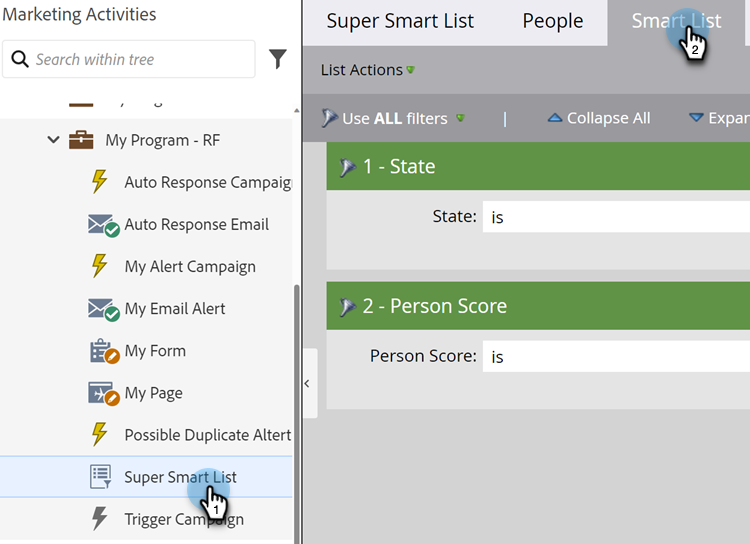
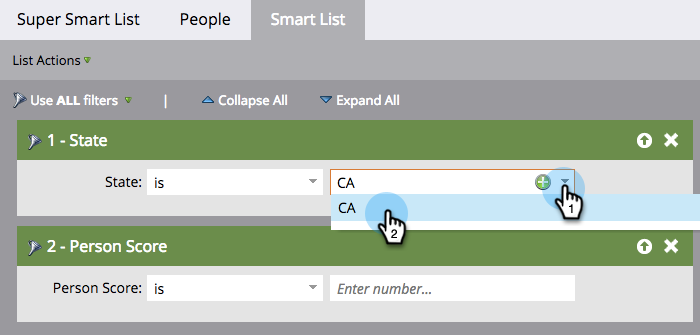
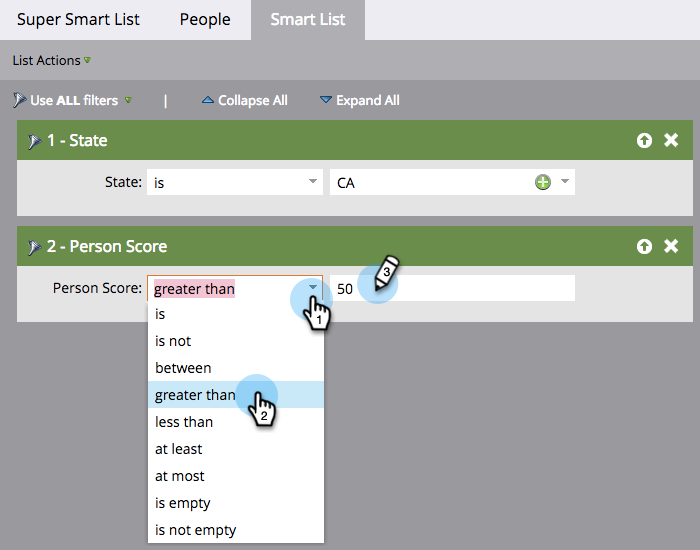

# Définir des filtres pour une liste intelligente {#define-smart-list-filters}

>[!PREREQUISITES]
>
>* [Créer une liste dynamique](/help/marketo/product-docs/core-marketo-concepts/smart-lists-and-static-lists/creating-a-smart-list/create-a-smart-list.md){target="_blank"}
>* [Rechercher et ajouter des filtres aux listes dynamiques](/help/marketo/product-docs/core-marketo-concepts/smart-lists-and-static-lists/creating-a-smart-list/find-and-add-filters-to-a-smart-list.md){target="_blank"}

Maintenant que vous avez [créé une liste dynamique](/help/marketo/product-docs/core-marketo-concepts/smart-lists-and-static-lists/creating-a-smart-list/create-a-smart-list.md){target="_blank"} et [ajouté des filtres](/help/marketo/product-docs/core-marketo-concepts/smart-lists-and-static-lists/creating-a-smart-list/find-and-add-filters-to-a-smart-list.md){target="_blank"}, définissez les filtres comme suit.

En poursuivant cet exemple, définissez ces filtres pour trouver toutes les personnes en Californie avec un score supérieur à 50.

1. Accédez à **[!UICONTROL Activités marketing]**.

   

1. Sélectionnez la liste dynamique souhaitée et cliquez sur l’onglet **[!UICONTROL Liste dynamique]**.

   

1. Recherchez et sélectionnez « CA » pour le filtre **[!UICONTROL État]**.

   

   >[!NOTE]
   >
   >Il se peut que vous stockiez à la fois « California » et « CA ». Pour filtrer les deux valeurs et inclure _toutes_ les personnes de Californie, apprenez à [ajouter plusieurs valeurs à un filtre de liste dynamique](/help/marketo/product-docs/core-marketo-concepts/smart-lists-and-static-lists/using-smart-lists/add-multiple-values-to-a-smart-list-filter.md){target="_blank"}.

1. Sélectionnez l’opérateur **[!UICONTROL supérieur à]** et saisissez « 50 ».

   

>[!TIP]
>
>Si vous pensez que certains enregistrements de votre base de données contiennent des adresses e-mail incomplètes (par exemple, « @adobe.com »), utilisez deux filtres d’adresse e-mail lorsque vous utilisez l’opérateur « contains ». Un filtre avec « contient @adobe.com » et un autre avec « contient adobe.com » (sans le symbole @).

Vous savez maintenant comment créer une liste dynamique et ajouter/définir des filtres.
