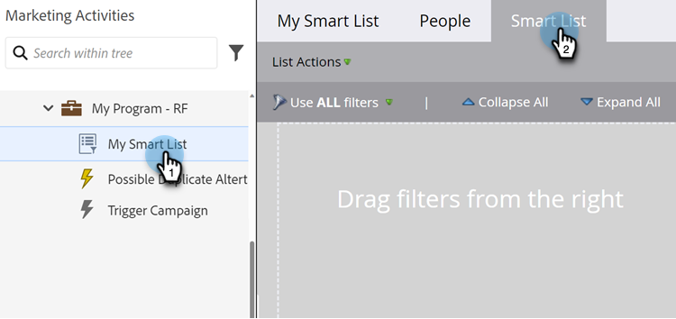
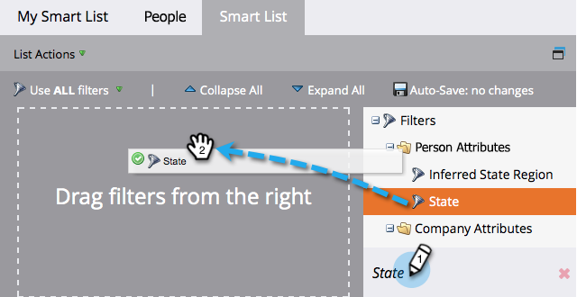
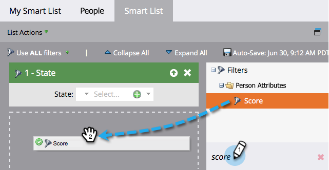

# Rechercher et ajouter des filtres à une liste intelligente {#find-and-add-filters-to-a-smart-list}

Après avoir [créé une liste dynamique](/help/marketo/product-docs/core-marketo-concepts/smart-lists-and-static-lists/creating-a-smart-list/create-a-smart-list.md){target="_blank"}, vous devez ajouter et [définir](/help/marketo/product-docs/core-marketo-concepts/smart-lists-and-static-lists/creating-a-smart-list/define-smart-list-filters.md){target="_blank"} des filtres.

Dans cet exemple, l’objectif est de trouver toutes les personnes en Californie avec un score supérieur à 50.

>[!TIP]
>
>Explorez l&#39;arbre à droite - les filtres sont très puissants et ont une grande variété de fonctions possibles.

1. Accédez à **[!UICONTROL Activités marketing]**.

   

1. Sélectionnez la liste dynamique à laquelle vous souhaitez ajouter des filtres et cliquez sur l’onglet **[!UICONTROL Liste dynamique]**.

   

1. Recherchez et faites glisser le filtre **[!UICONTROL State]** sur la zone de travail.

   

1. Recherchez également le filtre **[!UICONTROL Score]** et faites-le glisser dessus.

   

Définissez ces filtres.

>[!MORELIKETHIS]
>
>* [Créer une liste dynamique](/help/marketo/product-docs/core-marketo-concepts/smart-lists-and-static-lists/creating-a-smart-list/create-a-smart-list.md){target="_blank"}
>* [Définir des filtres de liste dynamique](/help/marketo/product-docs/core-marketo-concepts/smart-lists-and-static-lists/creating-a-smart-list/define-smart-list-filters.md){target="_blank"}
