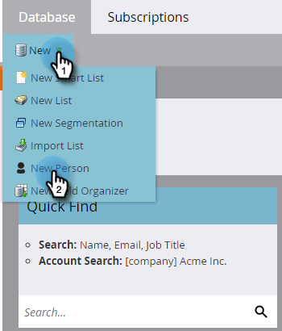
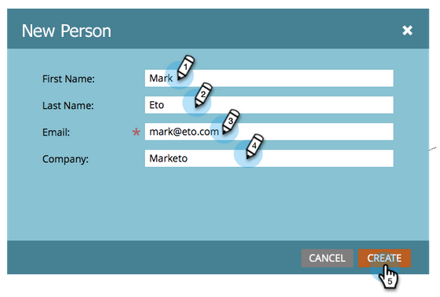

# Créer une personne manuellement {#create-a-person-manually}

Il existe de nombreuses façons d’intégrer une personne à Marketo Engage. Pour en créer un manuellement, procédez comme suit.

>[!CAUTION]
>
>Marketo ne prend pas en charge les adresses e-mail contenant des émoticônes.

1. Accédez à la **[!UICONTROL Base de données]**.

   

1. Sous **[!UICONTROL Nouveau]**, cliquez sur **[!UICONTROL Nouvelle personne]**.

   

1. Saisissez les informations sur la personne, puis cliquez sur **[!UICONTROL Créer]**.

   
