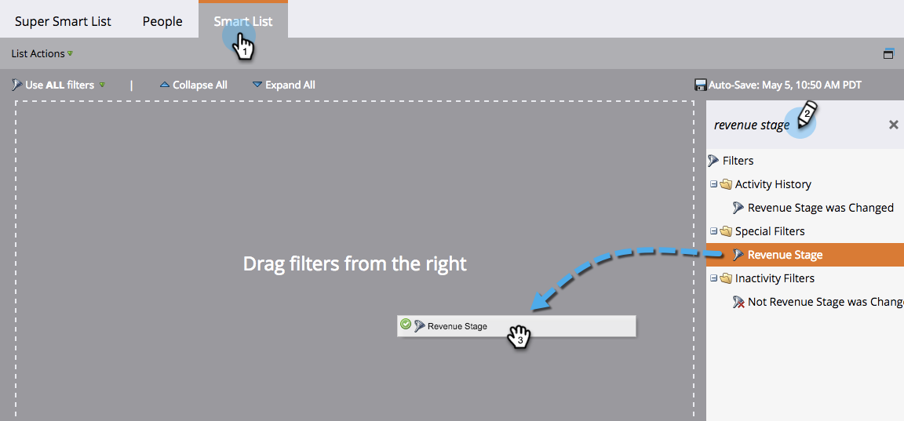
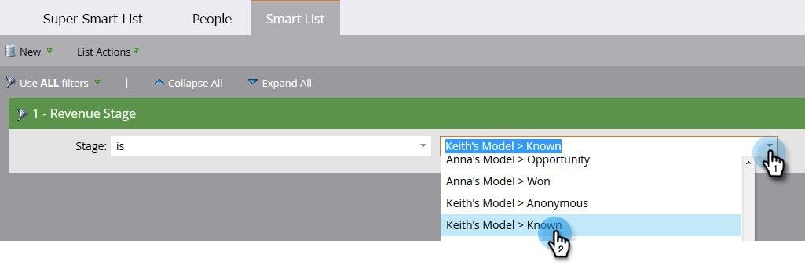
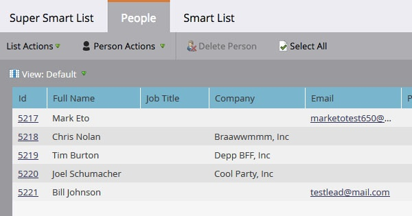
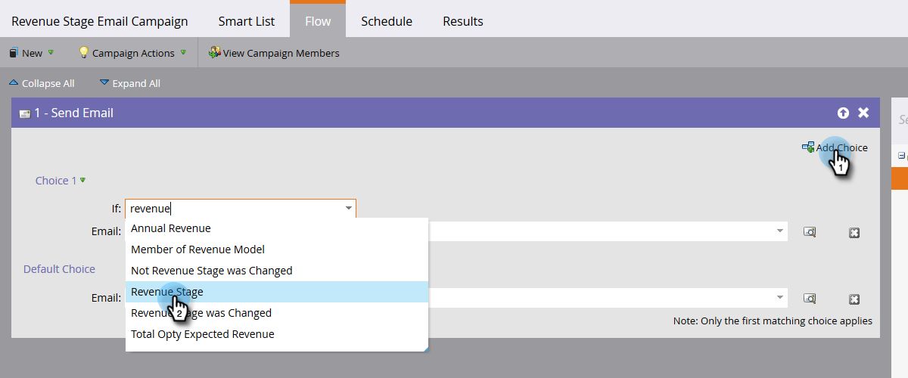

# Rechercher toutes les personnes présentes dans une étape de cycle de revenus {#find-all-people-in-a-revenue-stage}

>[!PREREQUISITES]
>
>[Créer une liste dynamique](/help/marketo/product-docs/core-marketo-concepts/smart-lists-and-static-lists/creating-a-smart-list/create-a-smart-list.md){target="_blank"}

## Rechercher tous les membres d’une étape de chiffre d’affaires spécifique {#find-all-members-of-a-specific-revenue-stage}

1. Dans une liste dynamique, cliquez sur l’onglet **[!UICONTROL Liste dynamique]**, recherchez le filtre **[!UICONTROL Étape de chiffre d’affaires]** et faites-le glisser dans la zone de travail.

   

1. Sélectionnez une **[!UICONTROL étape de chiffre d’affaires]**.

   

1. Accédez à l’onglet **[!UICONTROL Personnes]** pour afficher les résultats.

   

## Exécuter une étape de flux sur les membres d’une étape de revenus {#run-a-flow-step-on-the-members-of-a-revenue-stage}

Maintenant que vous savez quelles personnes se trouvent à quelles étapes du chiffre d’affaires, vous pouvez vous adresser directement à elles. En plus de choisir **[!UICONTROL Étape du chiffre d’affaires]** comme filtre de liste dynamique, vous pouvez également le choisir en tant que filtre « Si » dans le flux.

1. À l’étape de flux souhaitée, cliquez sur **[!UICONTROL Ajouter un choix]** et sélectionnez **[!UICONTROL Étape du chiffre d’affaires]** dans la liste déroulante.

   

   De là, vous pouvez choisir les membres qui sont affectés par l&#39;aspect de l&#39;étape de flux.
