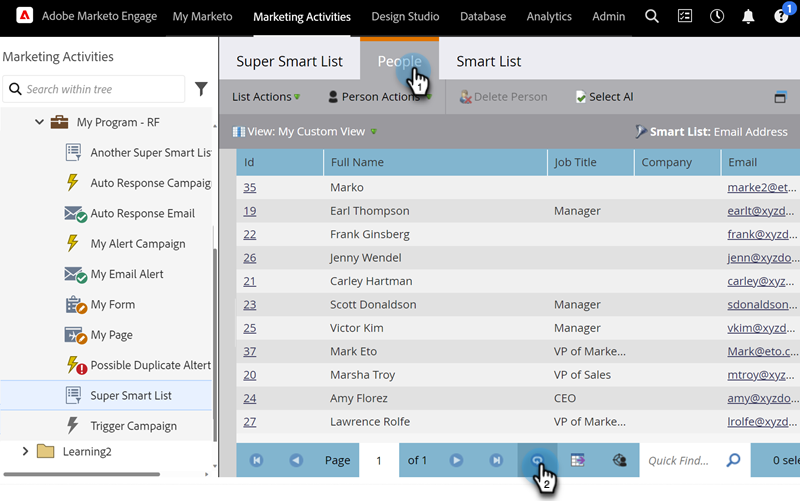

# Actualiser une liste ou une liste intelligente&#x200B; {#refresh-a-list-or-smart-list}

Si vous avez exécuté une liste dynamique et que quelques minutes se sont écoulées, les résultats peuvent être différents maintenant. Actualisez pour le découvrir.

## Actualiser les résultats {#refresh-results}

1. Pour mettre à jour les données de l’onglet **[!UICONTROL Personnes]** d’une liste dynamique, cliquez sur l’icône d’actualisation.

   

1. La liste dynamique s’exécute à nouveau et vous affiche un jeu de résultats plus récent.

   

>[!TIP]
>
>Parfois, lorsque vous exécutez une liste dynamique et que vous y revenez ultérieurement, il se peut que le mot « À propos » s’affiche devant le nombre de personnes dans le coin inférieur droit. Cela indique que le nombre est approximatif. Cliquez sur le nombre lui-même pour l’actualiser et obtenir un nombre précis et mis à jour.

>[!MORELIKETHIS]
>
>[Exporter des personnes vers Excel à partir d&#39;une liste ou d&#39;une liste dynamique](/help/marketo/product-docs/core-marketo-concepts/smart-lists-and-static-lists/managing-people-in-smart-lists/export-people-to-excel-from-a-list-or-smart-list.md){target="_blank"}
