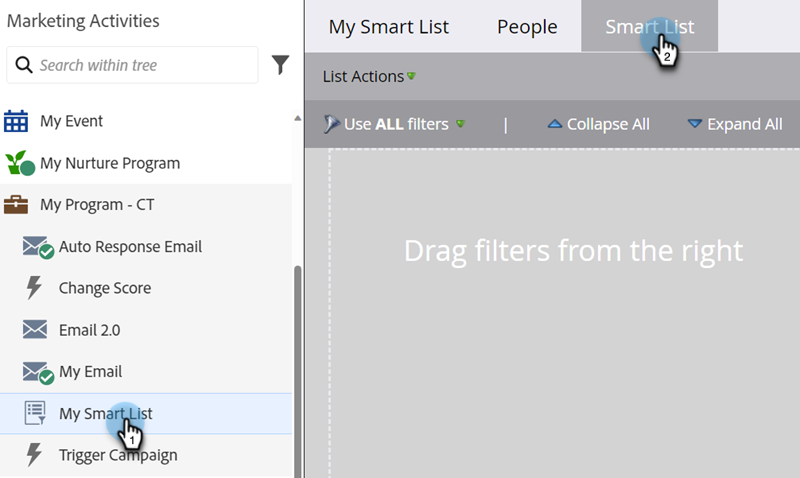
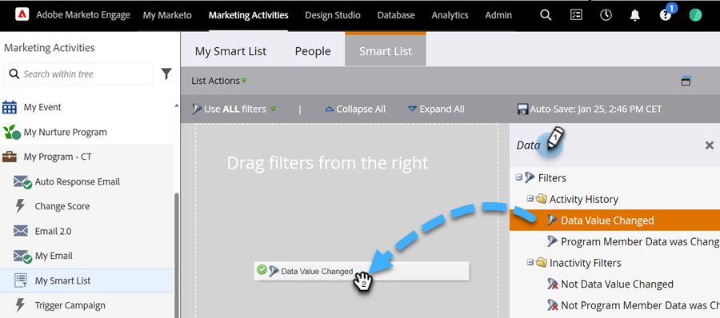
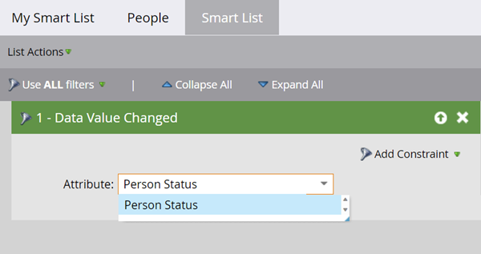

# Utiliser le filtre Valeurs de données modifiées dans une liste intelligente {#use-the-data-value-changed-filter-in-a-smart-list}

Les valeurs changent et sont constamment mises à jour dans votre base de données Marketo. Parfois, au lieu de rechercher une valeur spécifique, vous souhaitez rechercher des personnes qui ont subi un changement de valeur.

>[!PREREQUISITES]
>
>[Créer une liste dynamique](/help/marketo/product-docs/core-marketo-concepts/smart-lists-and-static-lists/creating-a-smart-list/create-a-smart-list.md){target="_blank"}

1. Accédez à la zone **[!UICONTROL Activités marketing]**.

   

1. Sélectionnez la liste dynamique et cliquez sur l’onglet **[!UICONTROL Liste dynamique]**.

   

1. Recherchez le filtre **[!UICONTROL Valeur des données modifiée]** et faites-le glisser sur la zone de travail.

   

1. Définissez **[!UICONTROL Attribut]** sur le champ sur lequel vous souhaitez rechercher les modifications de valeur de données.

   

Ce filtre recherche toutes les personnes dont le statut a été modifié (n’importe quel changement). Si vous souhaitez être encore plus sophistiqué, essayez [d’ajouter une contrainte à un filtre de liste dynamique](/help/marketo/product-docs/core-marketo-concepts/smart-lists-and-static-lists/using-smart-lists/add-a-constraint-to-a-smart-list-filter.md){target="_blank"}.
