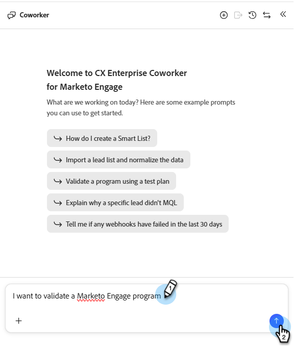
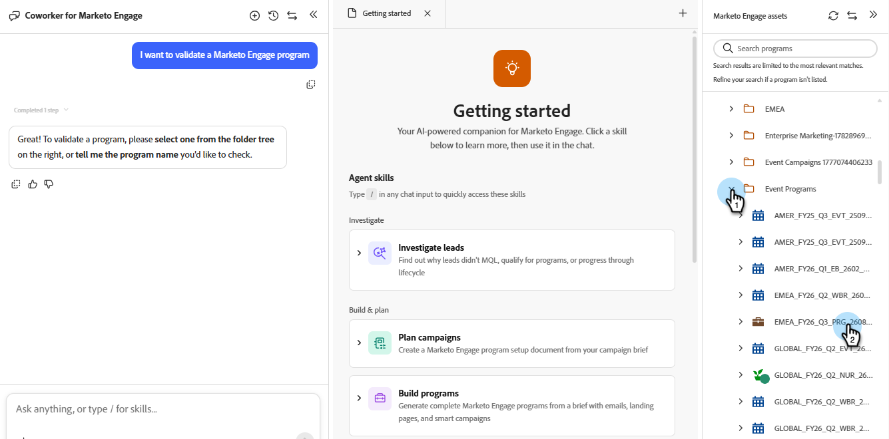
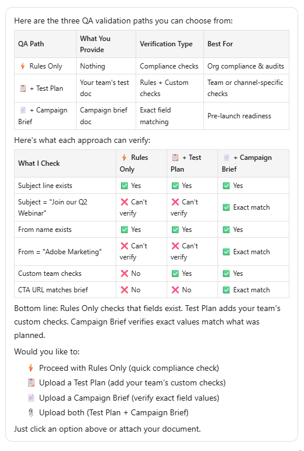

# Valider les programmes {#validate-programs}

Vérifiez vos programmes à la recherche des bonnes pratiques sur tous les composants, tels que les e-mails, les landing pages, les campagnes, etc.

## Utilisation {#how-to-use}

1. Dans Mon Marketo, cliquez sur la mosaïque **CX Enterprise Coworker pour Marketo Engage**.

   

1. Saisissez « Je souhaite valider un programme Marketo Engage » dans la fenêtre d’invite.

   

1. Sélectionnez le programme à valider dans le volet de droite.

   {width="800" zoomable="yes"}

   Un résumé du programme sélectionné s’affiche dans le volet central.

1. Dans la fenêtre d’invite, saisissez « valider le programme » et cliquez sur **Envoyer**.

   CX Enterprise Coworker for Marketo Engage fournit un contrôle qualité du programme sélectionné, vous indiquant ce qui a réussi et ce qui a échoué.

   
