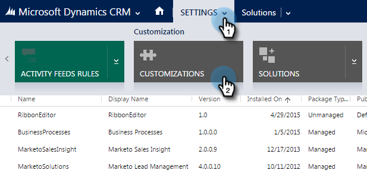
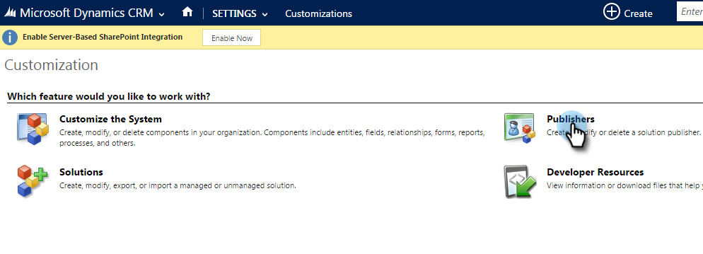
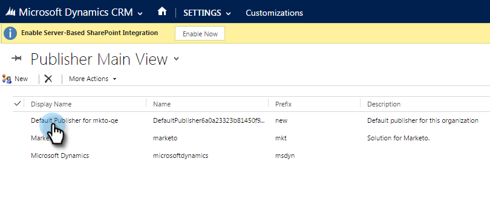
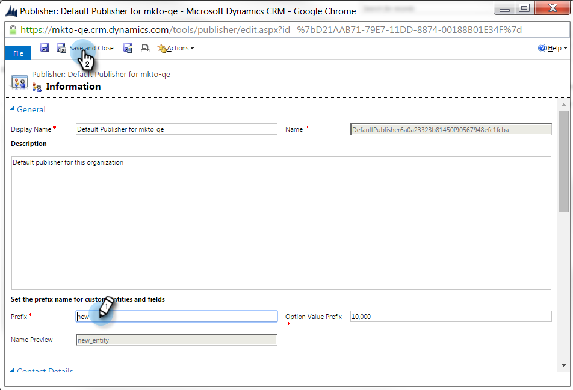
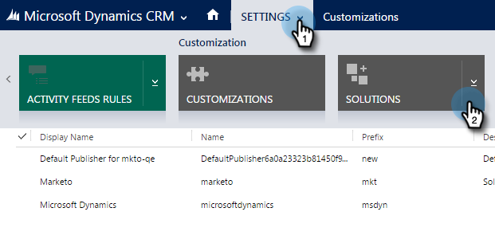
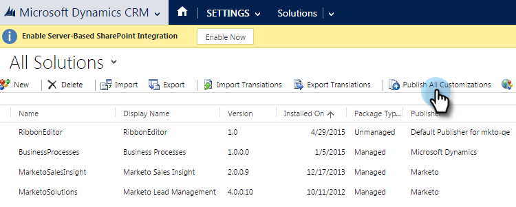

# Définir un préfixe de champ personnalisé par défaut {#set-a-default-custom-field-prefix}

Votre préfixe de [!DNL Microsoft Dynamics] par défaut pour les champs personnalisés doit être **nouveau** pour que les champs propriétaires de Marketo soient correctement synchronisés.

1. Accédez à [!UICONTROL Paramètres] et sélectionnez **[!UICONTROL Personnalisations].**

   

1. Cliquez sur **[!UICONTROL Éditeurs]**.

   

1. Sélectionnez l’éditeur par défaut dans la liste.

   

1. Remplacez le préfixe par **nouveau**. Cliquez sur **[!UICONTROL Enregistrer et fermer]**.

   

1. Accédez à [!UICONTROL Paramètres] > [!UICONTROL Solutions] pour publier les personnalisations.

   

1. Cliquez sur **[!UICONTROL Publier toutes les personnalisations]**.

   

1. Créez maintenant vos champs personnalisés. Une fois les tâches terminées, rétablit le préfixe d’origine.
