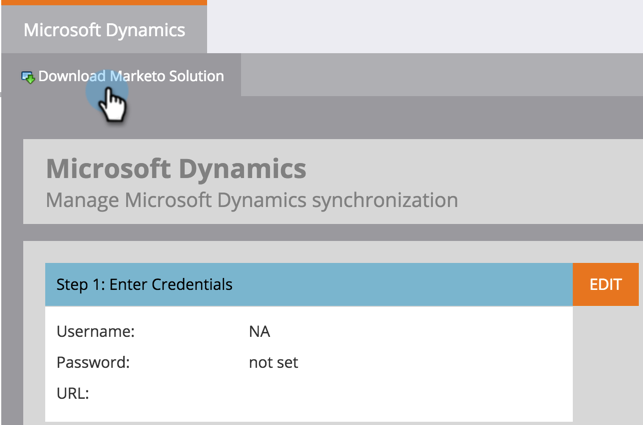

# Télécharger la solution de gestion des leads Marketo {#download-the-marketo-lead-management-solution}

>[!NOTE]
>
>**Autorisations d’administration requises**

Vous devrez télécharger et installer une solution Marketo dans votre compte [!DNL Microsoft Dynamics] pour que la synchronisation puisse commencer.

>[!CAUTION]
>
>il est impératif de télécharger la dernière solution Marketo _avant d_ effectuer une mise à niveau.

>[!NOTE]
>
>Actuellement, Marketo ne prend en charge que les certificats SSL compatibles avec Java 7.

1. Accédez à la zone **[!UICONTROL Admin]**.

   

1. Cliquez sur **[!UICONTROL CRM]**.

   

1. Sélectionnez **[!DNL Microsoft]**.

   

1. Sélectionnez **[!UICONTROL Télécharger la solution Marketo]**.

   

1. Sélectionnez la solution appropriée pour votre version de [!DNL Microsoft Dynamics].

   

Un fichier zip de la solution sera désormais téléchargé sur votre appareil.
