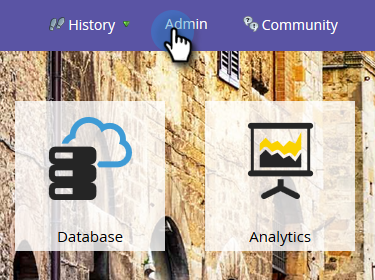
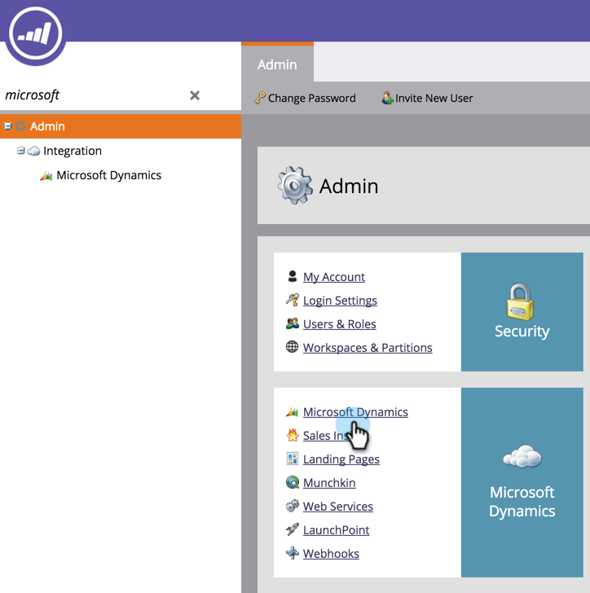
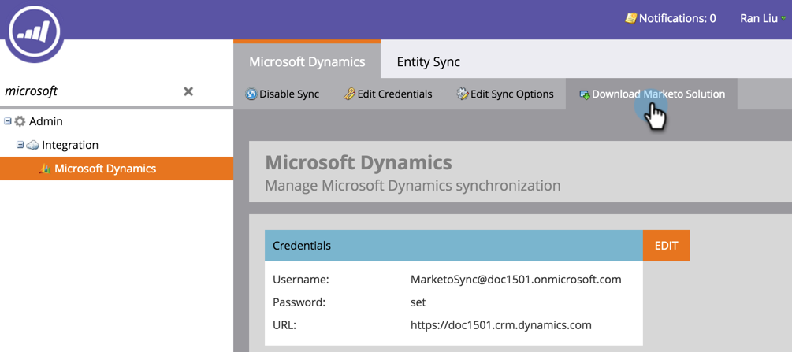
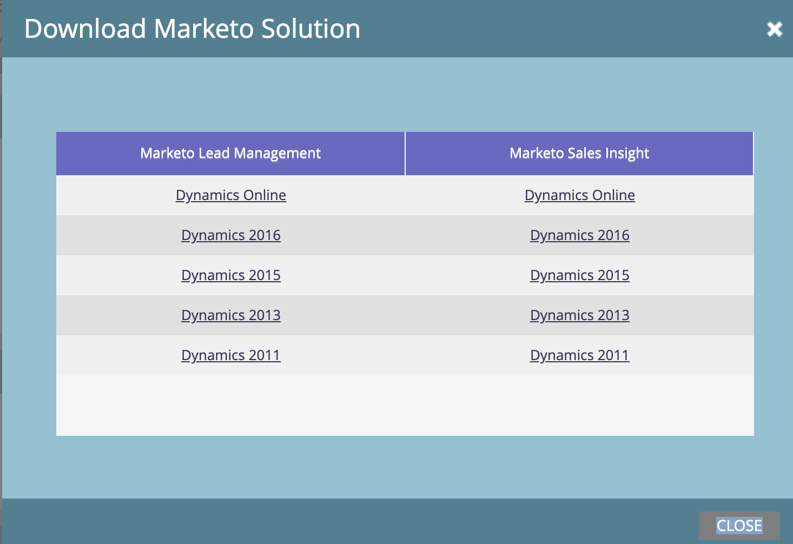
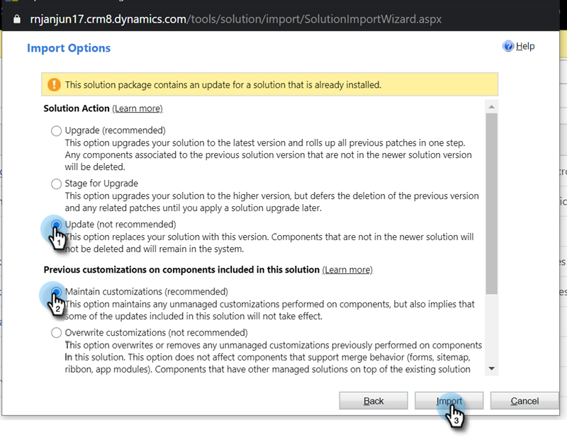

# Mise à jour de la solution Marketo pour [!DNL Microsoft Dynamics] {#update-the-marketo-solution-for-microsoft-dynamics}

Lorsqu’une nouvelle solution [!DNL Microsoft Dynamics] est publiée, vous pouvez télécharger la mise à jour depuis la zone Admin de votre compte.

>[!NOTE]
>
>**Autorisations d’administration requises**

>[!CAUTION]
>
>il est impératif de télécharger la dernière solution Marketo _avant d_ effectuer une mise à jour.

1. Accédez à la zone **[!UICONTROL Admin]**.

   

1. Cliquez sur **[!DNL Microsoft Dynamics]**.

   

1. Sélectionnez **[!UICONTROL Télécharger la solution Marketo]**.

   

1. Sélectionnez la solution appropriée pour votre version de [!DNL Microsoft Dynamics].

   

   Un fichier zip de la solution sera désormais téléchargé sur votre appareil. Si vous ne connaissez pas les étapes d’installation, contactez votre administrateur [!UICONTROL Dynamics].

## Exécution de la mise à jour {#performing-the-update}

1. Importez la dernière version de la solution par rapport à la version existante de votre CRM [!DNL Dynamics] (par exemple, si votre CRM [!DNL Dynamics] dispose de la version 1.4 et que la dernière version est la version 1.5, vous devez importer _plus_ la version 1.4).

1. Le pop-up suivant s’affiche. Sélectionnez **[!UICONTROL Mettre à jour]** et **[!UICONTROL Conserver les personnalisations]**, puis cliquez sur **[!UICONTROL Importer]**.

   

>[!CAUTION]
>
>Sélectionner Mettre à niveau au lieu de Mettre à jour peut entraîner une corruption des données dans votre environnement [!DNL Dynamics]. **Sélectionnez Mettre à jour** sous [!UICONTROL Options d’importation].
