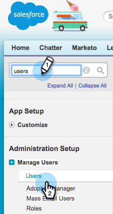
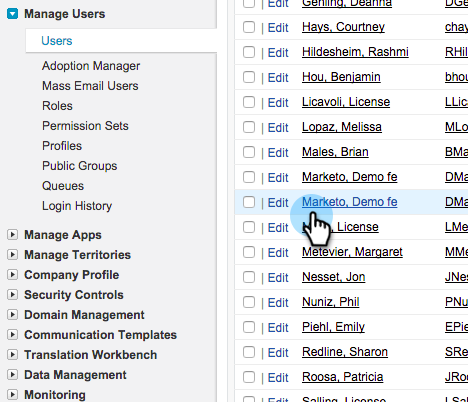
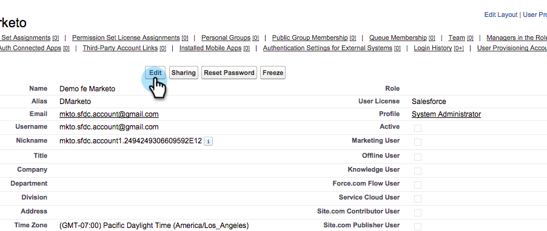
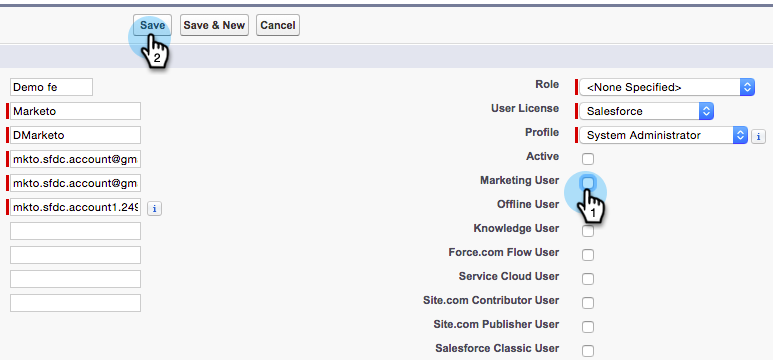

# Définir l’utilisateur de synchronisation Marketo comme utilisateur marketing {#make-marketo-sync-user-a-marketing-user}

L’utilisateur de la synchronisation Marketo [&#128279;](/help/marketo/product-docs/crm-sync/salesforce-sync/setup/enterprise-unlimited-edition/step-2-of-3-create-a-salesforce-user-for-marketo-enterprise-unlimited.md){target="_blank"} doit être un utilisateur marketing pour que la synchronisation de la campagne Salesforce fonctionne correctement. Voici comment faire de l’utilisateur un utilisateur marketing dans Salesforce.

>[!NOTE]
>
>**Autorisations d’administration requises**

1. Connectez-vous à Salesforce. Recherchez des utilisateurs dans la barre de recherche de gauche, puis cliquez sur **[!UICONTROL Utilisateurs]** sous **[!UICONTROL Gestion des utilisateurs]**.

   

1. Recherchez votre utilisateur de synchronisation et cliquez sur son nom.

   

1. Cliquez sur **[!UICONTROL Modifier]**.

   

1. Cochez la case **[!UICONTROL Utilisateur marketing]**, puis cliquez sur **[!UICONTROL Enregistrer]**.

   

   Cet utilisateur de synchronisation Marketo est désormais un utilisateur marketing.
