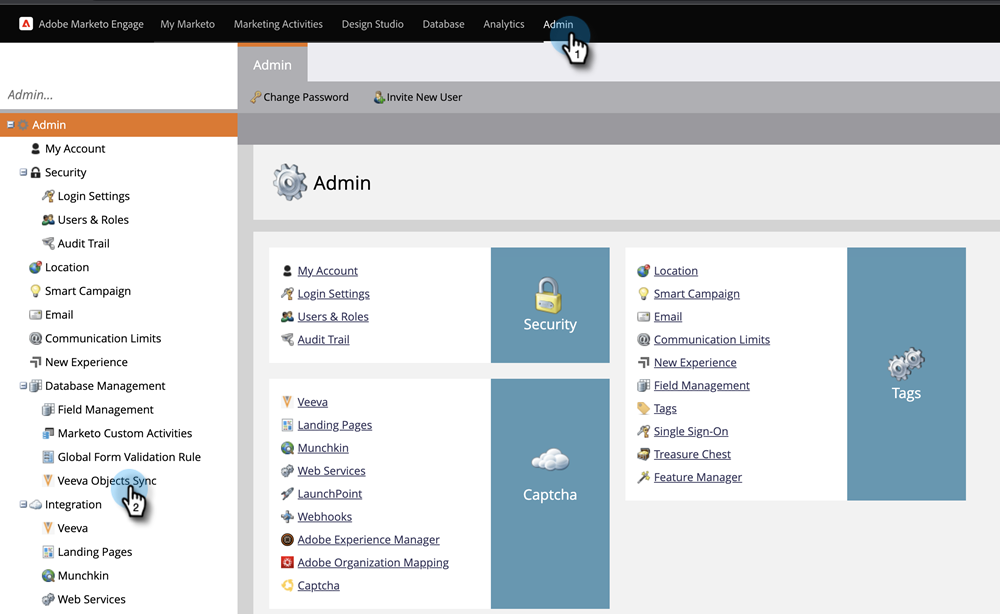
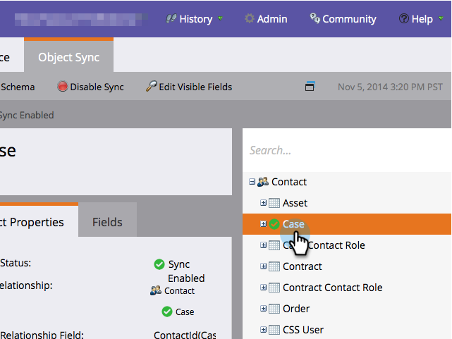
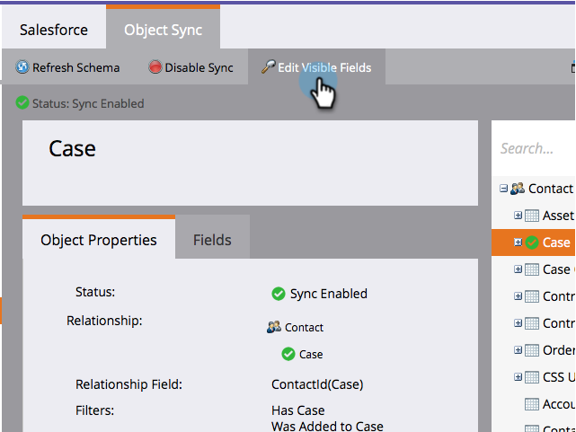
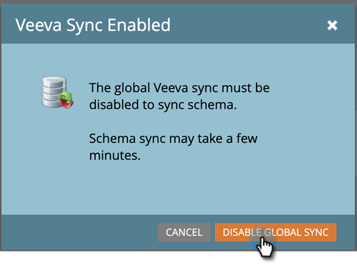
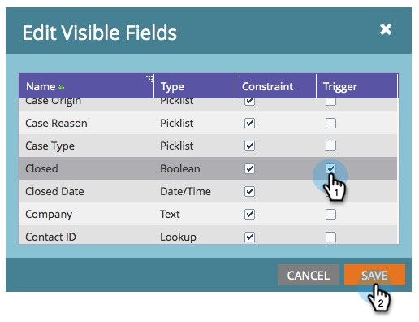
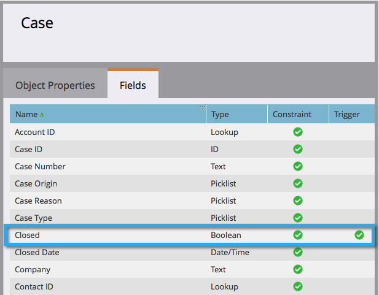

# Ajouter/supprimer un champ d’objet personnalisé en tant que contraintes de liste intelligente/déclencheur {#add-remove-custom-object-field-as-smart-list-trigger-constraints}

Marketo Engage offre un contrôle spécifique sur la synchronisation d’objets personnalisés [!DNL Veeva]. Vous pouvez ainsi sélectionner les champs disponibles en tant que contraintes dans les filtres d’objet personnalisés et les utiliser comme déclencheurs dans les campagnes intelligentes.

>[!NOTE]
>
>**Autorisations d’administration requises**

1. Cliquez sur **[!UICONTROL Admin]**, puis **[!UICONTROL Synchronisation des objets Veeva]**.

   

1. Sélectionnez l’objet que vous souhaitez modifier.

   

1. Cliquez sur **[!UICONTROL Modifier les champs visibles]**.

   

   >[!TIP]
   >
   >Si le bouton [!UICONTROL Modifier les champs visibles] est grisé, l’objet est actuellement utilisé dans une liste dynamique ou une campagne dynamique. Supprimez toutes les associations pour continuer.

1. Si la synchronisation globale est activée, cliquez sur **[!UICONTROL Désactiver la synchronisation globale]**.

   

1. Cochez les cases en regard des contraintes de filtre/déclencheur souhaitées et cliquez sur **[!UICONTROL Enregistrer]**.

   

   >[!NOTE]
   >
   >Tous les champs sont sélectionnés par défaut pour être des contraintes sur les filtres.

1. Cliquez sur l’onglet **[!UICONTROL Champs]** pour confirmer vos modifications.

   

>[!IMPORTANT]
>
>N’oubliez pas de réactiver la synchronisation globale.

Désormais, vos listes intelligentes et campagnes intelligentes ont encore plus de puissance.

>[!MORELIKETHIS]
>
>[Activer/Désactiver La Synchronisation Des Objets Personnalisés](/help/marketo/product-docs/crm-sync/veeva-crm-sync/sync-details/enable-disable-custom-object-sync.md){target="_blank"}
