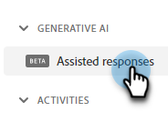
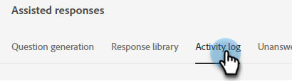
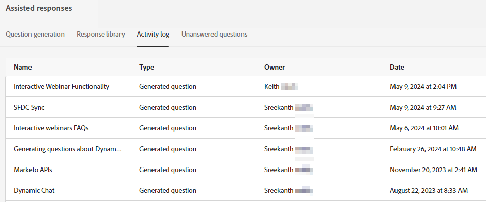

# Journal d’activité {#activity-log}

Voir une liste de toutes les tâches et les détails qui les accompagnent, y compris le nom, le propriétaire, le type, et qui les a modifiées et quand.

1. Sous IA générative, cliquez sur **[!UICONTROL Réponses assistées]**.

   

1. Cliquez sur l’onglet **[!UICONTROL Journal d’activité]**.

   

1. Toutes les activités de votre instance sont affichées au même endroit.

   
