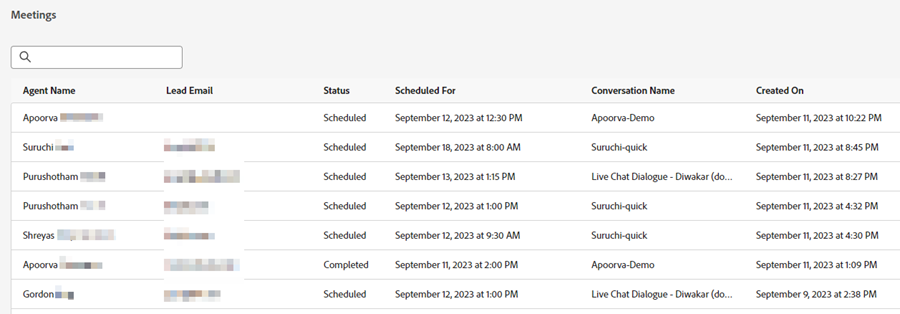
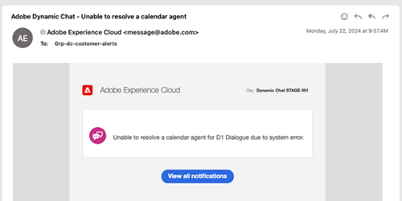

# Liste de réunions {#meeting-list}

C’est ici que s’affichent tous les rendez-vous planifiés par les visiteurs du site web via vos différents dialogues. Vous y trouverez l&#39;adresse e-mail de la personne qui a réservé le rendez-vous, l&#39;agent avec lequel elle a réservé le rendez-vous, la date prévue pour le rendez-vous et si l&#39;heure prévue pour la réunion est passée ou non.

>[!NOTE]
>
>Lorsqu’une réunion est réservée sur le calendrier d’un agent, l’agent reçoit une notification par e-mail à propos de la réservation, y compris des informations détaillées sur l’engagement Dynamic Chat du visiteur.

## Notifications d’action ayant échoué {#failed-action-notifications}

Lorsqu’une action telle qu’une réservation de réunion ou un chat en direct échoue, les utilisateurs sont avertis par e-mail.

