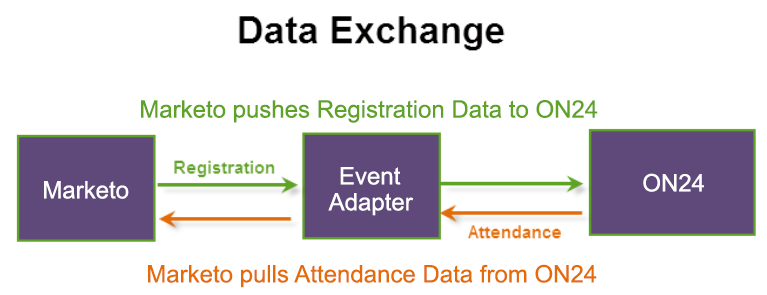

# Créer un événement dans Marketo {#create-an-event-in-marketo}

Un événement Marketo suit la progression de vos collaborateurs par le biais d’un programme. Il envoie les informations d&#39;inscription et extrait les informations de présence à l&#39;aide de l&#39;adaptateur ON24. L’événement capture le statut de vos salariés au fur et à mesure de leur progression.

Vous trouverez ci-dessous les modalités d’échange des données :

Lorsque vous créez l’événement Marketo, sélectionnez **Webinaire** comme type de canal. Vous pouvez modifier ce canal dans Admin et en créer un nouveau. Si vous créez un canal, il doit être du type **Événement avec webinaire** pour que l’intégration fonctionne. Voir [Créer un canal de programme](/help/marketo/product-docs/administration/tags/create-a-program-channel.md){target="_blank"} pour plus d’informations.

L’étape suivante consiste à [configurer les paramètres d’événement et synchroniser Marketo avec votre webinaire](/help/marketo/product-docs/demand-generation/events/create-an-event/create-an-event-with-the-marketo-on24-adapter/configure-event-settings-and-sync-marketo-with-your-webinar.md){target="_blank"}.

>[!MORELIKETHIS]
>
>[Présentation des événements de l&#39;adaptateur Marketo ON24](/help/marketo/product-docs/demand-generation/events/create-an-event/create-an-event-with-the-marketo-on24-adapter/understanding-marketo-on24-adapter-events.md){target="_blank"}
