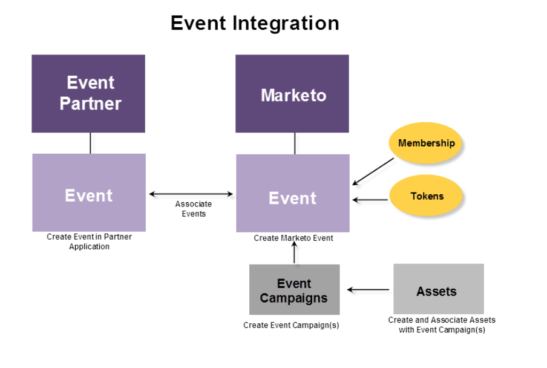

# Présentation des événements de l’adaptateur ON24 pour Marketo {#understanding-marketo-on-adapter-events}

Si votre webinaire ON24 n’est pas connecté à Marketo, vous devez prendre les informations du participant qui se trouvent déjà dans Marketo et les saisir dans ON24. Après le webinaire, vous devez récupérer les informations de présence qui se trouvent déjà dans ON24 et les entrer à nouveau dans Marketo.

L&#39;adaptateur ON24 effectue tout le transfert d&#39;informations pour vous. Il transmet les informations d’enregistrement capturées sur une page de destination Marketo à ON24 et intègre automatiquement les informations de présence dans un événement Marketo.

Ces articles vous guideront tout au long du processus de création d’un webinaire dans ON24, de création d’un événement dans Marketo et d’association.

Le graphique ci-dessous illustre le processus d’intégration.

Prêt à commencer ? Commencez par [Créer un événement avec l’adaptateur ON24](/help/marketo/product-docs/demand-generation/events/create-an-event/create-an-event-with-the-marketo-on24-adapter.md){target="_blank"}.
