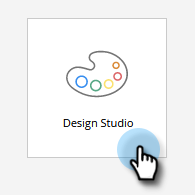
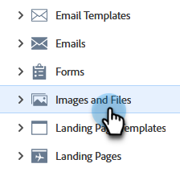
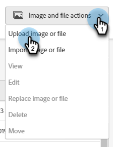
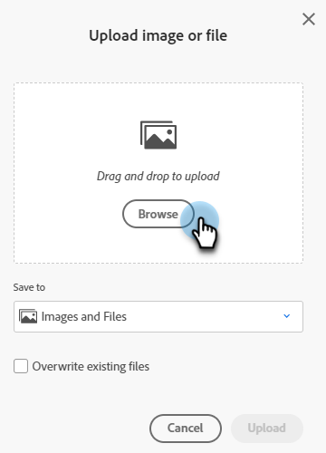
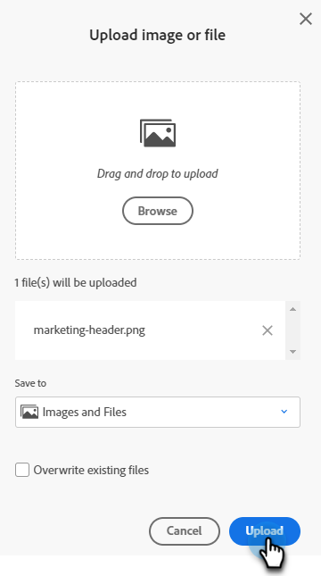

# Ajouter des images et des fichiers à Marketo {#add-images-and-files-to-marketo}

Découvrez comment ajouter de nouvelles images ou de nouveaux fichiers à votre instance Marketo Engage.

1. Accédez au **[!UICONTROL Design Studio]**.

   

1. Sélectionnez **[!UICONTROL Images et fichiers]**

   

1. Cliquez sur la liste déroulante **[!UICONTROL Actions relatives aux images et aux fichiers]** et sélectionnez **[!UICONTROL Charger une image ou un fichier]**.

   

1. Effectuez un glisser-déposer de l’image ou du fichier souhaité, ou recherchez-le sur votre ordinateur.

   

   >[!NOTE]
   >
   >La taille maximale par fichier est de 100MB.

1. Une fois la ressource sélectionnée, cliquez sur **Charger**.

   

   >[!NOTE]
   >
   >Marketo accepte tous les types de fichiers pour le chargement, mais uniquement les types d’images principaux (JPG, PNG, GIF, etc.) fonctionnera dans l’éditeur d’e-mail.

   >[!MORELIKETHIS]
   >
   >[Organisez vos images et fichiers à l’aide de dossiers](/help/marketo/product-docs/demand-generation/images-and-files/organize-your-images-and-files-using-folders.md){target="_blank"}
