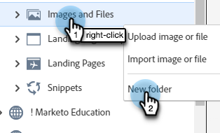
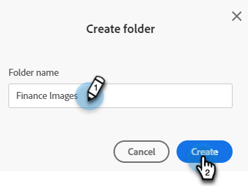
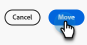

# Organiser vos images et fichiers à l’aide de dossiers {#organize-your-images-and-files-using-folders}

La création de dossiers vous permet de déplacer des images et des fichiers, de voir uniquement l’ensemble d’images souhaité et de les charger directement dans un dossier spécifique.

1. Accédez au **[!UICONTROL Design Studio]**.

   

1. Cliquez avec le bouton droit de la souris sur **[!UICONTROL Images et fichiers]** et sélectionnez **[!UICONTROL Nouveau dossier]**.

   

1. Nommez le dossier, puis cliquez sur **[!UICONTROL Créer]**.

   

1. Revenez à **[!UICONTROL Images et fichiers]** et sélectionnez la ressource à déplacer. Cliquez sur la liste déroulante **[!UICONTROL Actions relatives aux images et aux fichiers]** et sélectionnez **[!UICONTROL Déplacer]**.

   

1. Sélectionnez le dossier souhaité.

   

1. Cliquez sur **Déplacer**.

   

>[!MORELIKETHIS]
>
>[Rechercher les images et fichiers chargés](/help/marketo/product-docs/demand-generation/images-and-files/search-uploaded-images-and-files.md){target="_blank"}
