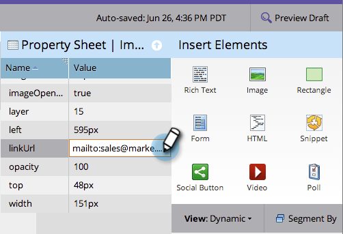

# Ajouter un lien vers une image de page de destination à structure libre {#add-a-link-to-a-free-form-landing-page-image}

>[!PREREQUISITES]
>
>[Ajouter une image à une page de destination de forme libre](/help/marketo/product-docs/demand-generation/landing-pages/free-form-landing-pages/add-an-image-to-a-free-form-landing-page.md)

>[!NOTE]
>
>Cela s’applique uniquement aux pages de destination de forme libre.

1. Sélectionnez l’image que vous avez ajoutée à votre page de destination et développez la **[!UICONTROL Feuille de propriétés]**.

   

1. Saisissez votre lien mailto dans le champ **[!UICONTROL linkUrl]**.

   

   Vous disposez désormais d’une image en tant que lien de publipostage sur votre page de destination Marketo.

   
